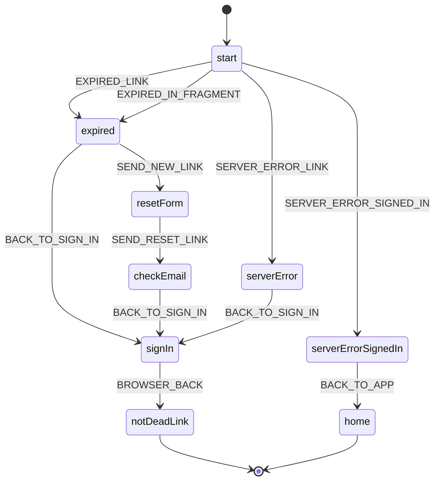

# Auth callback & reset

<!-- Generated by `pnpm e2e:models:docs` from the model `auth` in e2e/models. Do not edit by hand. -->

Expired reset link (query or fragment) → Send a new link → reset → Check your email → sign in; server error → Back to sign in; Back never returns to the dead link.

Starts as **admin**. States 9/9 and transitions 11/11 covered by 5 generated paths (7 Playwright tests).

## States

| State | The user sees |
| --- | --- |
| `start` | Nothing open yet. |
| `expired` | "Link expired" (role alert) with Send a new link and Back to sign in; no endless spinner. |
| `resetForm` | "Reset password" with an email field and Send reset link; the callback address is gone. |
| `checkEmail` | "Check your email" with the address, and Back to sign in. |
| `serverError` | "Sign-in didn’t complete" (role alert) with Back to sign in and no Send a new link. |
| `signIn` | The sign-in screen: an email field, no error, not on /auth/callback. |
| `notDeadLink` | Back from sign-in: still not the callback, no error shown. |
| `serverErrorSignedIn` | Signed in already: "Sign-in didn’t complete" with Back to sign in. |
| `home` | Home, not on /auth/callback. |

## Events

| Event | The user does |
| --- | --- |
| `EXPIRED_LINK` | Signed out, on sign-in: open /auth/callback?bw_recovery=1&error=access_denied&error_code=otp_expired… |
| `EXPIRED_IN_FRAGMENT` | Signed out, on sign-in: open the same error in the URL fragment (#error=…). |
| `SERVER_ERROR_LINK` | Signed out, on sign-in: open /auth/callback?error=server_error… |
| `SERVER_ERROR_SIGNED_IN` | Signed in: open /auth/callback?error=server_error… |
| `SEND_NEW_LINK` | Tap Send a new link. |
| `SEND_RESET_LINK` | Type an email, tap Send reset link. |
| `BACK_TO_SIGN_IN` | Tap Back to sign in. |
| `BACK_TO_APP` | Tap Back to sign in. |
| `BROWSER_BACK` | Browser Back. |

## Generated paths

| Test | Profiles |
| --- | --- |
| Auth callback & reset: EXPIRED_IN_FRAGMENT | phone-portrait |
| Auth callback & reset: EXPIRED_LINK → BACK_TO_SIGN_IN → BROWSER_BACK | phone-portrait |
| Auth callback & reset: EXPIRED_LINK → SEND_NEW_LINK → SEND_RESET_LINK → BACK_TO_SIGN_IN | phone-portrait, ipad-landscape, duo-laptop |
| Auth callback & reset: SERVER_ERROR_LINK → BACK_TO_SIGN_IN | phone-portrait |
| Auth callback & reset: SERVER_ERROR_SIGNED_IN → BACK_TO_APP | phone-portrait |

## Not in the demo (manual)

- A real expired or used link from Supabase, a code exchanged twice, a reset link opened in another browser ("other_browser"), and the new password form after a valid link: the demo has no auth server.
- Native deep links (Capacitor launch URL handled once): device only.
