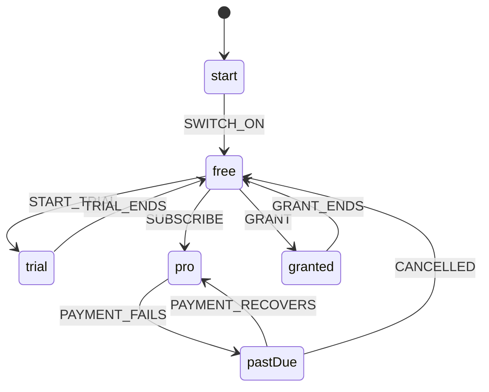

# Band plan (trial, paid, past due, grant)

<!-- Generated by `pnpm e2e:models:docs` from the model `band-plan` in e2e/models. Do not edit by hand. -->

With the plans on, the admin sees the band move between Free, a trial, a paid plan, a failed payment and a plan offered by BandWith.

Starts as **admin**. States 6/6 and transitions 9/9 covered by 4 generated paths (4 Playwright tests).

## States

| State | The user sees |
| --- | --- |
| `start` | The app as in the beta: plans switched off. |
| `free` | Settings → Plan: Free, "Every tool, with limits on how many." and the meters. *(PlanSection.tsx; planText.ts planLine, planUsageRows)* |
| `trial` | Pro, "Trial: 9 days left."; no meters for the counted limits left (Pro has none written). *(resolvePlan (trial); planLine)* |
| `pro` | Pro, "Paid by you." *(resolvePlan (paid, active); planLine (is_payer))* |
| `pastDue` | Still Pro (inside the grace days), "The last payment didn’t go through. Update the card to keep Pro." *(resolvePlan (past_due, grace_days); planLine)* |
| `granted` | Pro, "Offered by BandWith." (no end date). *(resolvePlan (grant, grant_until NULL); planLine)* |

## Events

| Event | The user does |
| --- | --- |
| `SWITCH_ON` | The server turns plans_enforced on (demo: platform_switches row), with test limits. |
| `START_TRIAL` | A trial starts (demo: band_plans trial, trialing, ends in 9 days). |
| `TRIAL_ENDS` | The trial end date passes (demo: trial_ends_at yesterday). |
| `SUBSCRIBE` | The webhook records a paid Pro (demo: band_plans paddle active, the demo user pays). |
| `PAYMENT_FAILS` | The webhook records past_due (demo: status past_due, since today; grace 14 days). |
| `PAYMENT_RECOVERS` | The webhook records the payment (demo: status active). |
| `CANCELLED` | The subscription ends (demo: status canceled). |
| `GRANT` | BandWith offers Pro forever, e.g. the partner band (demo: band_plans grant, no end). |
| `GRANT_ENDS` | The grant ends (demo: grant_until yesterday). |

## Generated paths

| Test | Profiles |
| --- | --- |
| Band plan (trial, paid, past due, grant): SWITCH_ON → GRANT → GRANT_ENDS | phone-portrait |
| Band plan (trial, paid, past due, grant): SWITCH_ON → START_TRIAL → TRIAL_ENDS | phone-portrait |
| Band plan (trial, paid, past due, grant): SWITCH_ON → SUBSCRIBE → PAYMENT_FAILS → CANCELLED | phone-portrait |
| Band plan (trial, paid, past due, grant): SWITCH_ON → SUBSCRIBE → PAYMENT_FAILS → PAYMENT_RECOVERS | phone-portrait |

## Not in the demo (manual)

- Members see the plan only: e2e/specs/plans.spec.ts ("member: the plan only").
- The same rules on the server: 19 cases in src/lib/__fixtures__/planCases.json, checked in SQL by the rollback dry run of 160.
- Real payments (Paddle) arrive in P6; the webhook writes the same rows these events write.
