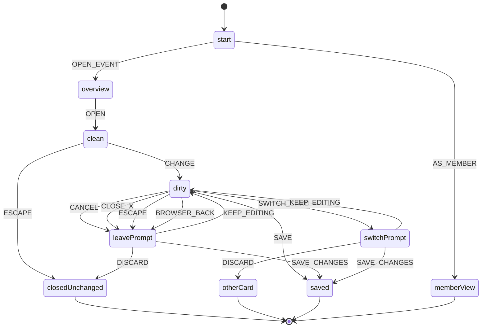

# Overview card edit

<!-- Generated by `pnpm e2e:models:docs` from the model `card-edit` in e2e/models. Do not edit by hand. -->

An admin opens a card editor on a gig or rehearsal overview, changes it, and leaves, switches or saves.

Starts as **admin**. States 10/10 and transitions 17/17 covered by 12 generated paths (14 Playwright tests).

Runs for each of: hero, venue, lineup, fee, to-dos, client & notes, studio cost (one per path, in turn; every one for ).

## States

| State | The user sees |
| --- | --- |
| `start` | Home. |
| `overview` | The event overview with an edit control on the card. *(EventDetail.tsx canEditOverview)* |
| `clean` | The card's editor with the saved values; Save disabled. *(OverviewEditSheets.tsx EditSheet)* |
| `closedUnchanged` | No question: the editor closes and the overview shows the saved value. *(EditSheet requestClose (dirty false))* |
| `dirty` | The editor with the change; Save enabled. |
| `leavePrompt` | "Save your changes?" with Save changes, Discard and Keep editing, over the editor. *(UnsavedChanges.tsx UnsavedChangesSheet)* |
| `switchPrompt` | "Save your changes?" over the editor, the other card's editor not open yet. *(OverviewEditSheets.tsx SwitchRequest)* |
| `otherCard` | The other card's editor is open; the first card kept its saved value. |
| `saved` | The editor closes and the overview shows the new value at once; the demo database has it. *(useOverviewEdit.ts onPatched)* |
| `memberView` | A member opening the same gig and rehearsal finds no edit control on any card. *(EventDetail.tsx canEditOverview (isAdmin))* |

## Events

| Event | The user does |
| --- | --- |
| `OPEN_EVENT` | Open the card's event (Rooftop Session, or Weekly rehearsal for studio cost) from the calendar. |
| `AS_MEMBER` | Become a member of the band and open Rooftop Session, then Weekly rehearsal. |
| `OPEN` | Tap the card's edit control. |
| `CHANGE` | Change one value in the editor. |
| `ESCAPE` | System Back: Escape with no field focused. |
| `BROWSER_BACK` | System Back: the browser's Back. |
| `CANCEL` | Tap Cancel. |
| `CLOSE_X` | Tap ✕. |
| `SAVE` | Tap Save. |
| `SWITCH_CARD` | Tap another card's edit control on the overview pane. *(only on duo-book)* |
| `KEEP_EDITING` | Tap Keep editing. |
| `DISCARD` | Tap Discard. |
| `SAVE_CHANGES` | Tap Save changes. |

## Generated paths

| Test | Profiles | Variants |
| --- | --- | --- |
| Overview card edit: AS_MEMBER | phone-portrait | hero |
| Overview card edit: OPEN_EVENT → OPEN → CHANGE → BROWSER_BACK | phone-portrait, ipad-landscape, duo-laptop | venue |
| Overview card edit: OPEN_EVENT → OPEN → CHANGE → CANCEL → DISCARD | phone-portrait | lineup |
| Overview card edit: OPEN_EVENT → OPEN → CHANGE → CANCEL → KEEP_EDITING | phone-portrait | fee |
| Overview card edit: OPEN_EVENT → OPEN → CHANGE → CANCEL → SAVE_CHANGES | phone-portrait | to-dos |
| Overview card edit: OPEN_EVENT → OPEN → CHANGE → CLOSE_X | phone-portrait | client & notes |
| Overview card edit: OPEN_EVENT → OPEN → CHANGE → ESCAPE | phone-portrait | studio cost |
| Overview card edit: OPEN_EVENT → OPEN → CHANGE → SAVE | phone-portrait | hero |
| Overview card edit: OPEN_EVENT → OPEN → CHANGE → SWITCH_CARD → DISCARD | duo-book | venue |
| Overview card edit: OPEN_EVENT → OPEN → CHANGE → SWITCH_CARD → KEEP_EDITING | duo-book | lineup |
| Overview card edit: OPEN_EVENT → OPEN → CHANGE → SWITCH_CARD → SAVE_CHANGES | duo-book | fee |
| Overview card edit: OPEN_EVENT → OPEN → ESCAPE | phone-portrait | to-dos |
