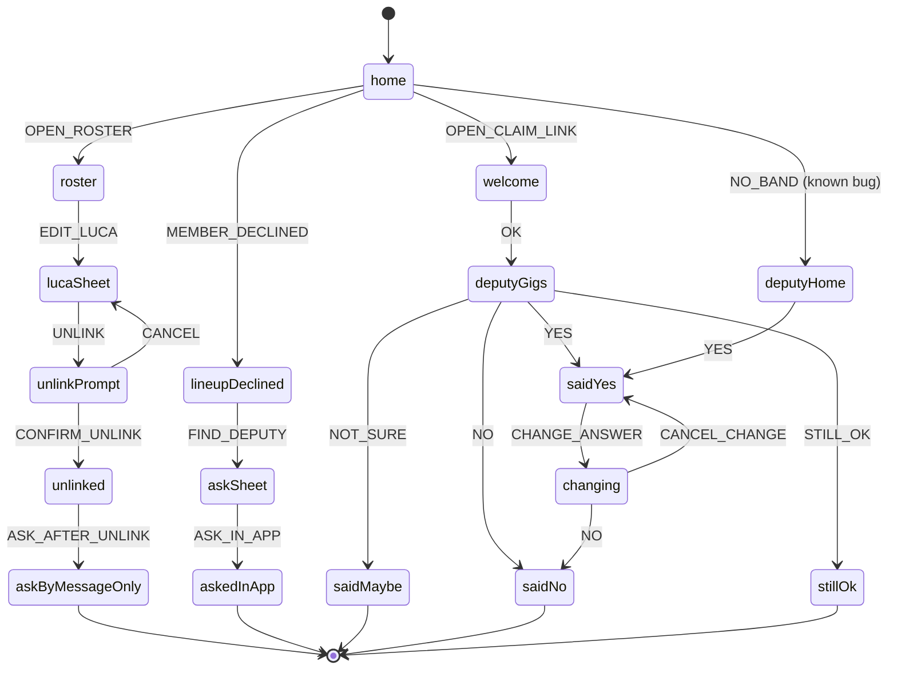

# Deputies

<!-- Generated by `pnpm e2e:models:docs` from the model `deputy` in e2e/models. Do not edit by hand. -->

Admin: deputy list → ask a deputy in the app for a member who declined → unlink the account. Deputy: claim link → Deputy gigs → Yes / Not sure / No → change the answer; no-band home.

Starts as **admin**. States 17/17 and transitions 20/20 covered by 9 generated paths (10 Playwright tests).

## States

| State | The user sees |
| --- | --- |
| `home` | Home (admin). |
| `roster` | Band members → Deputies: Luca T. "On BandWith", Noa B. and Ivo M. without; "Only admins see this list." |
| `lucaSheet` | Edit deputy Luca T.: "On BandWith", "Luca T. answers in the app", Unlink account. |
| `unlinkPrompt` | "Unlink BandWith account?": links already sent stop working; Cancel and Unlink. |
| `unlinked` | "Unlinked. Send the next request by message…"; no "On BandWith" and no Unlink account any more; saved without the account. |
| `askByMessageOnly` | Find a deputy: Luca T. is no longer "On BandWith" and has no "Ask in the app", only the message buttons. |
| `lineupDeclined` | The Wedding's lineup: Lena P. declined, with "Find a deputy" next to her. |
| `askSheet` | "Find a deputy", "Replacing Lena P."; Luca T. "On BandWith" with "Ask in the app"; Noa B. and Ivo M. by message only. |
| `askedInApp` | "Sent in the app: they get a notification."; Luca T.'s request is "Asked · no answer yet"; saved as pending for the Wedding. |
| `welcome` | The claim link opens Deputy gigs: "You're on The Late Shift's deputy list", "Your gigs with The Late Shift are below." |
| `deputyGigs` | Deputy gigs: Jazz Brunch "Waiting for your answer" with Yes / Not sure yet / No, I can't and no street address; Summer Wedding "Something changed". |
| `saidYes` | Jazz Brunch: "You said yes", the street address, Change your answer; saved as available. |
| `changing` | The answers again, with Cancel. |
| `saidMaybe` | Jazz Brunch: "You'll confirm later", no street address; saved as maybe. |
| `saidNo` | Jazz Brunch: "You said you can't", no street address; saved as unavailable. |
| `stillOk` | Summer Wedding: no "Something changed" any more, still "You said yes". |
| `deputyHome` | No band of its own: Deputy gigs is the home screen, with "Playing in a band too?" and the requests to answer. |

## Events

| Event | The user does |
| --- | --- |
| `OPEN_ROSTER` | Settings → Members → Deputies. |
| `EDIT_LUCA` | Tap Luca T. |
| `UNLINK` | Tap Unlink account. |
| `CANCEL` | Tap Cancel. |
| `CONFIRM_UNLINK` | Tap Unlink. |
| `ASK_AFTER_UNLINK` | Close; Lena P. declines the Wedding; open its lineup, Find a deputy. |
| `MEMBER_DECLINED` | Lena P. declines the Wedding; open it, Open lineup details. |
| `FIND_DEPUTY` | Tap Find a deputy next to Lena P. |
| `ASK_IN_APP` | Tap Ask in the app on Luca T. |
| `OPEN_CLAIM_LINK` | Open the deputy link /?deputy=<token> (the demo user plays for The Late Shift). |
| `OK` | Tap OK on the welcome. |
| `YES` | Jazz Brunch: tap Yes. |
| `NOT_SURE` | Jazz Brunch: tap Not sure yet. |
| `NO` | Jazz Brunch: tap No, I can't. |
| `CHANGE_ANSWER` | Tap Change your answer. |
| `CANCEL_CHANGE` | Tap Cancel. |
| `STILL_OK` | Summer Wedding: tap Still OK. |
| `NO_BAND` | The account leaves its band (deputy gigs only), opens the app again. |

## Generated paths

| Test | Profiles |
| --- | --- |
| Deputies: MEMBER_DECLINED → FIND_DEPUTY → ASK_IN_APP | phone-portrait |
| Deputies: NO_BAND → YES → CHANGE_ANSWER → CANCEL_CHANGE | phone-portrait |
| Deputies: NO_BAND → YES → CHANGE_ANSWER → NO **(known bug: not run on duo-laptop)** | phone-portrait, ipad-landscape, duo-laptop |
| Deputies: OPEN_CLAIM_LINK → OK → NO | phone-portrait |
| Deputies: OPEN_CLAIM_LINK → OK → NOT_SURE | phone-portrait |
| Deputies: OPEN_CLAIM_LINK → OK → STILL_OK | phone-portrait |
| Deputies: OPEN_CLAIM_LINK → OK → YES | phone-portrait |
| Deputies: OPEN_ROSTER → EDIT_LUCA → UNLINK → CANCEL | phone-portrait |
| Deputies: OPEN_ROSTER → EDIT_LUCA → UNLINK → CONFIRM_UNLINK → ASK_AFTER_UNLINK | phone-portrait |

## Known bugs

- **NO_BAND** — deputy, duo-laptop (left out only on duo-laptop)
  - Actual: On the Duo in Laptop pose (fold y 455–495) the standalone Deputy gigs home is one long scrolling page: Jazz Brunch's "Message to the band" field sits across the fold (TEXTAREA @y476..546), and scrolling moves the answer buttons through it.
  - Expected: Nothing the user can touch sits on the fold in Laptop pose, as on every other screen (e2e/support/health.ts onFold, e2e/README.md "@laptop … nothing may sit on the fold"). DeputyHome.tsx wraps DeputyGigsScreen in DuoAuthLayout, which only lays out the open (two-pane) display, so the Laptop pose gets no fold-aware layout.
  - Evidence: `e2e/.results-known-bugs/deputy-home-laptop-fold/ (trace.zip, test-failed-1.png)` (local, re-create with `E2E_KNOWN_BUGS=1`)

## Not in the demo (manual)

- Two accounts: the admin's request reaching the deputy's notifications and their answer reaching the admin ("Available"): the demo has one user, and its deputy gigs are a separate demo table (demo_deputy_gigs) for another band.
- Claiming a link for the first time ("From now on {band} can ask you in the app"), a link of another account, and the link a band member opens: the demo claim always answers "already" (demoClient.ts bw_deputy_claim).
- After an unlink, links already sent stop working (087 rotates the tokens) and the deputy no longer sees the band's gigs: server only.
- The public reply page /deputy.html and the calendar feed: no backend in the demo.
- Push notifications for requests, recaps and updates: device only.
