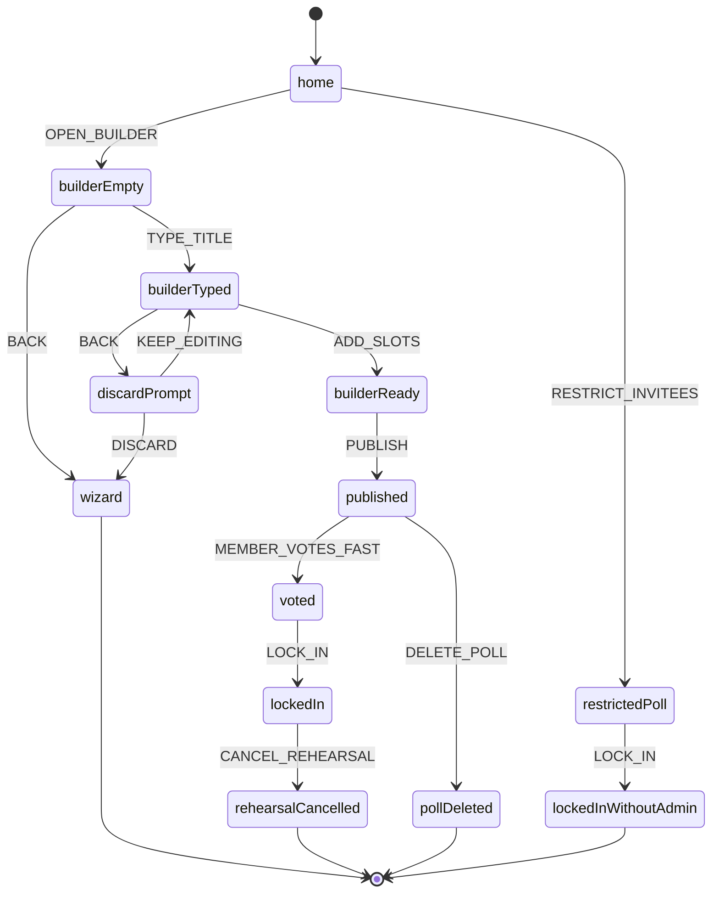

# Availability poll

<!-- Generated by `pnpm e2e:models:docs` from the model `poll` in e2e/models. Do not edit by hand. -->

Build (Back / discard / keep editing) → publish → member votes → lock in → rehearsal, or cancel.

Starts as **admin**. States 13/13 and transitions 14/14 covered by 6 generated paths (8 Playwright tests).

## States

| State | The user sees |
| --- | --- |
| `home` | Home with the seeded poll "Extra rehearsal next week". |
| `builderEmpty` | "Availability poll" with its default title (nothing typed) and Publish poll disabled (no slots). |
| `builderTyped` | The builder with the typed title. |
| `discardPrompt` | "Discard this poll?" with Keep editing and Discard. *(RehearsalPollModal.tsx leave())* |
| `wizard` | The rehearsal wizard's first step, no "Discard this poll?" and no poll saved. |
| `builderReady` | "Candidate slots · 4" (Mon–Thu next week) and Publish poll enabled. |
| `published` | "Rehearsal availability poll published to band!"; Home shows the poll, "0 of 5 answered"; the database has it as polling with everyone invited. |
| `voted` | As a member, after taps Mon, Tue, Mon, Tue, Mon: Mon pressed, Tue not, and the database keeps only the Mon vote. *(pollVoteSync.ts)* |
| `lockedIn` | "Rehearsal scheduled and added to the calendar!"; the rehearsal is on the calendar; the admin (publisher, so invited) is on its roster as confirmed; the poll is confirmed. *(rehearsalPolls.ts finalizePollIntoRehearsal)* |
| `rehearsalCancelled` | The rehearsal is gone from the calendar and the database. |
| `pollDeleted` | "Rehearsal poll deleted."; the poll leaves Home and the database. |
| `restrictedPoll` | The seeded poll asks only Jonah, Marta and Lena: the admin's card says "Not invited". *(098 invited_user_ids; RehearsalPollCard.tsx)* |
| `lockedInWithoutAdmin` | The rehearsal is created with Jonah, Marta and Lena; the admin, not invited and no vote, is not on its roster. *(rehearsalPolls.ts finalizePollIntoRehearsal (adminVoted))* |

## Events

| Event | The user does |
| --- | --- |
| `OPEN_BUILDER` | Create → New rehearsal → Poll availability. |
| `BACK` | Tap the builder's Back. |
| `TYPE_TITLE` | Type a poll title. |
| `KEEP_EDITING` | Tap Keep editing. |
| `DISCARD` | Tap Discard. |
| `ADD_SLOTS` | Next week, then Add selected days to poll. |
| `PUBLISH` | Tap Publish poll. |
| `MEMBER_VOTES_FAST` | As a member, tap Mon, Tue, Mon, Tue, Mon on the poll in quick succession. |
| `LOCK_IN` | As the admin: Details · Lock in → Lock in on the top pick → Confirm & create event. |
| `CANCEL_REHEARSAL` | Open the new rehearsal and delete it. |
| `DELETE_POLL` | Details · Lock in → Delete poll → Delete poll. |
| `RESTRICT_INVITEES` | The seeded poll invites Jonah, Marta and Lena only (not the admin). |

## Generated paths

| Test | Profiles |
| --- | --- |
| Availability poll: OPEN_BUILDER → BACK | phone-portrait |
| Availability poll: OPEN_BUILDER → TYPE_TITLE → ADD_SLOTS → PUBLISH → DELETE_POLL | phone-portrait |
| Availability poll: OPEN_BUILDER → TYPE_TITLE → ADD_SLOTS → PUBLISH → MEMBER_VOTES_FAST → LOCK_IN → CANCEL_REHEARSAL | phone-portrait |
| Availability poll: OPEN_BUILDER → TYPE_TITLE → BACK → DISCARD | phone-portrait |
| Availability poll: OPEN_BUILDER → TYPE_TITLE → BACK → KEEP_EDITING | phone-portrait |
| Availability poll: RESTRICT_INVITEES → LOCK_IN | phone-portrait, ipad-landscape, duo-laptop |
