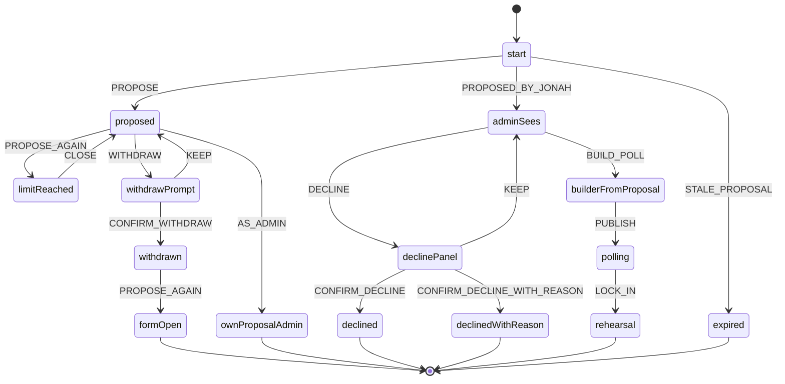

# Rehearsal proposal

<!-- Generated by `pnpm e2e:models:docs` from the model `proposal` in e2e/models. Do not edit by hand. -->

Member proposes → admin sees "Open until" → Build poll (→ rehearsal), Decline with or without a reason, expiry; weekly limit; withdraw.

Starts as **member**. States 15/15 and transitions 17/17 covered by 9 generated paths (9 Playwright tests).

## States

| State | The user sees |
| --- | --- |
| `start` | Home (member). |
| `proposed` | Home shows "Your rehearsal proposal · Pending admin · Open until Thu, Nov 19"; saved as proposed. |
| `limitReached` | "Weekly limit reached" with "Next available proposal" (in 7 days); no proposal form. |
| `withdrawPrompt` | "Withdraw your proposal?" — "The admins will no longer see it." with Cancel and Withdraw. |
| `withdrawn` | "Proposal withdrawn."; the card is gone and the proposal is deleted. |
| `formOpen` | The proposal form opens again: a withdrawn proposal doesn't count toward the weekly limit. |
| `ownProposalAdmin` | The same proposal for the admin: "Member rehearsal proposal", "Open until Thu, Nov 19", Decline and Build poll. |
| `adminSees` | The admin's Home: "Member rehearsal proposal" by Jonah R., "Open until Thu, Nov 19", Decline and Build poll. |
| `declinePanel` | "Decline this proposal?" with an optional reason, Cancel and Decline. |
| `declined` | "Proposal declined."; the card is gone; status cancelled; Jonah gets "Rehearsal proposal declined" without a reason. |
| `declinedWithReason` | As declined, and Jonah's notice ends with "Reason: Room booked all week". |
| `builderFromProposal` | The poll builder: "From Jonah R.:", the topic as title, Thu preselected. |
| `polling` | The proposal is now a poll ("Poll · Active") under the same title; status polling. |
| `rehearsal` | Locked in: the rehearsal is on the calendar and the proposal is confirmed. |
| `expired` | A proposal sent 9 days ago with no preferred day (open until 7 days after it was sent) is in no list. *(proposalExpiry.ts isProposalExpired; rehearsalPolls.ts getRehearsalPolls)* |

## Events

| Event | The user does |
| --- | --- |
| `PROPOSE` | Create → Propose rehearsal: topic, Thu, Submit to admin ("Proposal sent to band admin."). |
| `PROPOSE_AGAIN` | Create → Propose rehearsal again. |
| `CLOSE` | Tap Close. |
| `WITHDRAW` | Tap Withdraw on the proposal. |
| `KEEP` | Tap Cancel. |
| `CONFIRM_WITHDRAW` | Tap Withdraw in the question. |
| `AS_ADMIN` | The same user becomes the band's admin (same device). |
| `PROPOSED_BY_JONAH` | As the admin, with a proposal Jonah R. sent today for Thu. |
| `STALE_PROPOSAL` | As the admin, with a proposal Jonah R. sent 9 days ago with no day. |
| `DECLINE` | Tap Decline on the proposal. |
| `CONFIRM_DECLINE` | Tap Decline in the panel with no reason. |
| `CONFIRM_DECLINE_WITH_REASON` | Type a reason, tap Decline. |
| `BUILD_POLL` | Tap Build poll. |
| `PUBLISH` | Add next week's days, Publish poll. |
| `LOCK_IN` | Details · Lock in → Lock in → Confirm & create event. |

## Generated paths

| Test | Profiles |
| --- | --- |
| Rehearsal proposal: PROPOSE → AS_ADMIN | phone-portrait |
| Rehearsal proposal: PROPOSE → PROPOSE_AGAIN → CLOSE | phone-portrait |
| Rehearsal proposal: PROPOSE → WITHDRAW → CONFIRM_WITHDRAW → PROPOSE_AGAIN | phone-portrait |
| Rehearsal proposal: PROPOSE → WITHDRAW → KEEP | phone-portrait |
| Rehearsal proposal: PROPOSED_BY_JONAH → BUILD_POLL → PUBLISH → LOCK_IN | phone-portrait |
| Rehearsal proposal: PROPOSED_BY_JONAH → DECLINE → CONFIRM_DECLINE | phone-portrait |
| Rehearsal proposal: PROPOSED_BY_JONAH → DECLINE → CONFIRM_DECLINE_WITH_REASON | phone-portrait |
| Rehearsal proposal: PROPOSED_BY_JONAH → DECLINE → KEEP | phone-portrait |
| Rehearsal proposal: STALE_PROPOSAL | phone-portrait |

## Not in the demo (manual)

- The proposer's push for a declined proposal (push delivery is device-only); the in-app notice row is checked.
- The server-side weekly limit (can_member_propose_rehearsal) and the daily expiry cron (bw_expire_rehearsal_proposals): the demo has no database, so only the client checks run.
