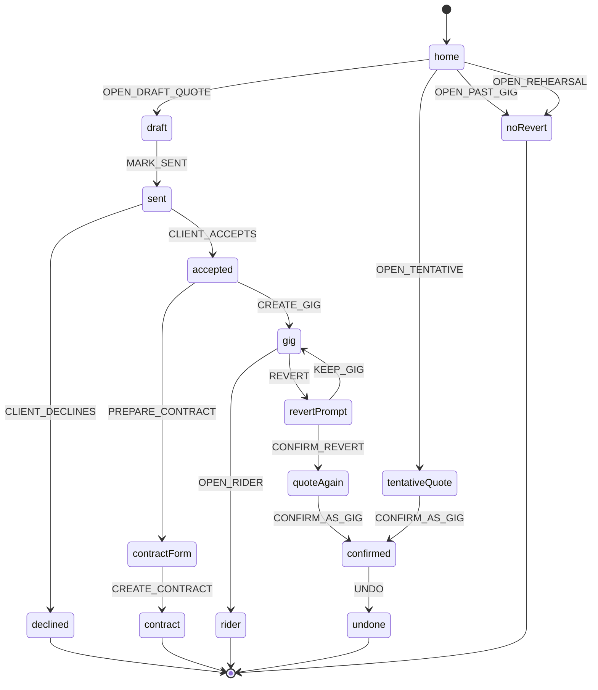

# Quote to gig

<!-- Generated by `pnpm e2e:models:docs` from the model `quote` in e2e/models. Do not edit by hand. -->

Draft → sent → client accepts (demo: the admin records it) or declines once → gig → contract / rider; revert to quote where allowed.

Starts as **admin**. States 15/15 and transitions 17/17 covered by 8 generated paths (10 Playwright tests).

## States

| State | The user sees |
| --- | --- |
| `home` | Home. |
| `draft` | Q-2026-0012 "40th birthday party": Draft, "Mark as sent", and no Accepted / Declined. |
| `sent` | Sent, "Client answered by phone or in person?" with Declined and Accepted; saved as sent. |
| `declined` | Declined, and no Accepted / Declined buttons any more; saved as declined. |
| `accepted` | "Create gig from quote" and "Prepare contract"; saved as accepted. |
| `contractForm` | "Create contract" with the title "Performance agreement · 40th birthday party". |
| `contract` | Contracts & docs lists the new contract as a draft for 40th birthday party. |
| `gig` | "Gig created from the quote"; the gig "40th birthday party" is open, confirmed, with REVERT TO QUOTE; the quote points to it. |
| `rider` | Rider & stage of the new gig: CREATE RIDER. |
| `revertPrompt` | "Revert to quote?" with Revert to quote and Keep the gig. |
| `quoteAgain` | A quote again: CONFIRM AS GIG, no REVERT TO QUOTE; event tentative, quote back to sent. |
| `tentativeQuote` | Jazz Club Night is a quote: CONFIRM AS GIG, no REVERT TO QUOTE. |
| `confirmed` | "Quote confirmed as Gig!" with UNDO; the event is confirmed. |
| `undone` | UNDO: the event is a quote (tentative) again. |
| `noRevert` | A past gig (Summer Fest Opening) or a rehearsal: no REVERT TO QUOTE. *(EventDetail.tsx canRevertToQuote / isPast)* |

## Events

| Event | The user does |
| --- | --- |
| `OPEN_DRAFT_QUOTE` | Home → Drafts → the quote draft → Quotes → "40th birthday party". |
| `MARK_SENT` | Tap Mark as sent (the quote closes to the list), open it again. |
| `CLIENT_DECLINES` | The client says no by phone: tap Declined ("Quote marked as declined"), open the quote again. |
| `CLIENT_ACCEPTS` | The client says yes by phone: tap Accepted ("Quote accepted. Open it to create the gig."), open the quote again. |
| `CREATE_GIG` | Tap Create gig from quote. |
| `PREPARE_CONTRACT` | Tap Prepare contract. |
| `CREATE_CONTRACT` | Tap Create contract. |
| `OPEN_RIDER` | Open Rider & stage from the gig. |
| `REVERT` | Tap REVERT TO QUOTE. |
| `KEEP_GIG` | Tap Keep the gig. |
| `CONFIRM_REVERT` | Tap Revert to quote. |
| `CONFIRM_AS_GIG` | Tap CONFIRM AS GIG. |
| `UNDO` | Tap UNDO on the toast. |
| `OPEN_TENTATIVE` | Open Jazz Club Night (a tentative gig: a quote) from the calendar. |
| `OPEN_PAST_GIG` | Open Summer Fest Opening (past) from the calendar's search. |
| `OPEN_REHEARSAL` | Open Weekly rehearsal from the calendar. |

## Generated paths

| Test | Profiles |
| --- | --- |
| Quote to gig: OPEN_DRAFT_QUOTE → MARK_SENT → CLIENT_ACCEPTS → CREATE_GIG → OPEN_RIDER | phone-portrait |
| Quote to gig: OPEN_DRAFT_QUOTE → MARK_SENT → CLIENT_ACCEPTS → CREATE_GIG → REVERT → CONFIRM_REVERT → CONFIRM_AS_GIG | phone-portrait |
| Quote to gig: OPEN_DRAFT_QUOTE → MARK_SENT → CLIENT_ACCEPTS → CREATE_GIG → REVERT → KEEP_GIG | phone-portrait |
| Quote to gig: OPEN_DRAFT_QUOTE → MARK_SENT → CLIENT_ACCEPTS → PREPARE_CONTRACT → CREATE_CONTRACT | phone-portrait |
| Quote to gig: OPEN_DRAFT_QUOTE → MARK_SENT → CLIENT_DECLINES | phone-portrait |
| Quote to gig: OPEN_PAST_GIG | phone-portrait |
| Quote to gig: OPEN_REHEARSAL | phone-portrait |
| Quote to gig: OPEN_TENTATIVE → CONFIRM_AS_GIG → UNDO | phone-portrait, ipad-landscape, duo-laptop |

## Not in the demo (manual)

- The client's own answer on /quote.html (bw_quote_link_respond, 120): the demo client has no quote page backend, so the admin records the answer ("Client answered by phone or in person?"), as the Academy describes for answers outside the link.
- A client who declined and accepts later on the page (120 allows it): needs the real quote page.
- Sending the quote (share sheet, WhatsApp / email) and the PDF: native sharing.
