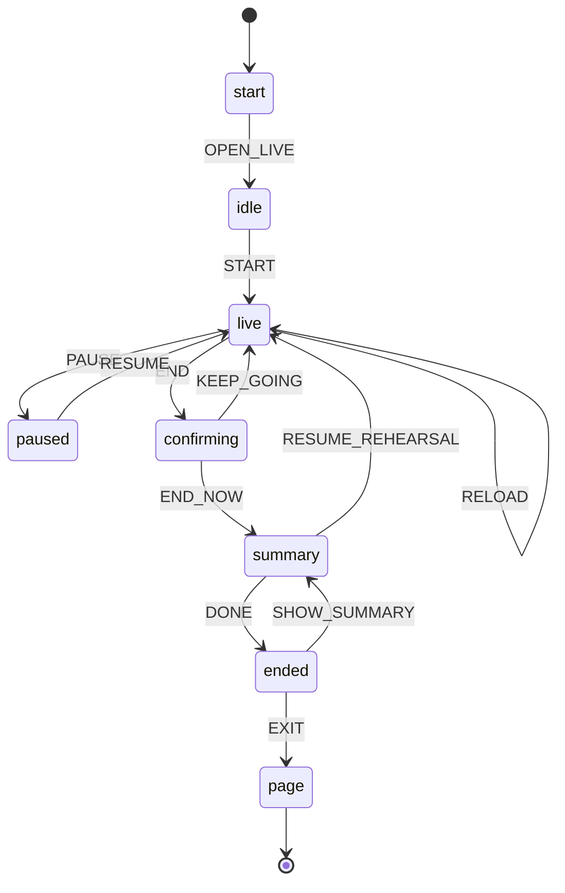

# Rehearsal session (Live mode)

<!-- Generated by `pnpm e2e:models:docs` from the model `rehearsal-live` in e2e/models. Do not edit by hand. -->

The admin starts, pauses, resumes and ends a rehearsal in Live mode; the summary is saved and shown on the rehearsal page.

Starts as **admin**. States 8/8 and transitions 12/12 covered by 6 generated paths (6 Playwright tests).

## States

| State | The user sees |
| --- | --- |
| `start` | Nothing open yet: the first event seeds "Weekly rehearsal" with three focus songs and opens it. |
| `idle` | Live mode on "Weekly rehearsal" with "Start rehearsal" and no clock; nothing saved yet. *(RehearsalSession.tsx RehearsalSessionBar (status idle, admin))* |
| `live` | The clock runs, "Rehearsing", Pause and End; the session is saved with no end. *(RehearsalSessionBar (live); useRehearsalSession commit → saveRehearsalSession)* |
| `paused` | "Paused", the clock stands still, Resume; the saved session has a pause start. *(rehearsalSession.ts pauseSession / elapsedSeconds)* |
| `confirming` | "End rehearsal?" with Keep going and End now; nothing ended yet. *(RehearsalSessionBar confirmEnd)* |
| `summary` | The rehearsal summary: "N of 3 songs played" with the songs played, Resume rehearsal and Done; the saved session has an end and its songs. *(RehearsalSummaryDialog; rehearsalSession.ts buildSummary)* |
| `ended` | The bar says "Ended" with Summary; no Pause or End. *(RehearsalSessionBar (ended))* |
| `page` | Back on the rehearsal: the REHEARSAL SESSION card says "Ended" and how many songs were played. *(EventDetail.tsx REHEARSAL SESSION; RehearsalSessionCard)* |

## Events

| Event | The user does |
| --- | --- |
| `OPEN_LIVE` | Open "Weekly rehearsal" and tap Open live mode. |
| `START` | Tap Start rehearsal. |
| `PAUSE` | Tap Pause. |
| `RESUME` | Tap Resume. |
| `END` | Tap End. |
| `KEEP_GOING` | Tap Keep going. |
| `END_NOW` | Tap End now (after moving on to the second song). |
| `DONE` | Tap Done in the summary. |
| `RESUME_REHEARSAL` | Tap Resume rehearsal in the summary. |
| `SHOW_SUMMARY` | Tap Summary. |
| `EXIT` | Tap Exit live mode. |
| `RELOAD` | Restart the app, open the rehearsal and Live mode again. |

## Generated paths

| Test | Profiles |
| --- | --- |
| Rehearsal session (Live mode): OPEN_LIVE → START → END → END_NOW → DONE → EXIT | phone-portrait |
| Rehearsal session (Live mode): OPEN_LIVE → START → END → END_NOW → DONE → SHOW_SUMMARY | phone-portrait |
| Rehearsal session (Live mode): OPEN_LIVE → START → END → END_NOW → RESUME_REHEARSAL | phone-portrait |
| Rehearsal session (Live mode): OPEN_LIVE → START → END → KEEP_GOING | phone-portrait |
| Rehearsal session (Live mode): OPEN_LIVE → START → PAUSE → RESUME | phone-portrait |
| Rehearsal session (Live mode): OPEN_LIVE → START → RELOAD | phone-portrait |

## Not in the demo (manual)

- The member's side (the same clock, no controls, the summary at the end) runs in e2e/specs/rehearsal-session.spec.ts with two devices in one browser.
- Offline in the rehearsal room: the admin's changes are kept on the device and saved when back online (vitest useRehearsalSession); Bluetooth carries song changes but not the session.
- Duo Laptop: the floor wedge shows the session clock and Pause / Resume (rehearsal-session.spec @smoke); starting and ending are done unfolded.
