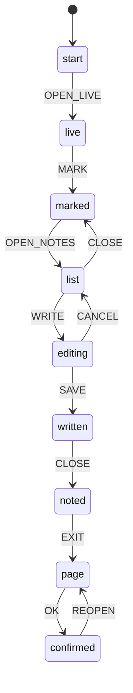

# Rehearsal note (mark, write, OK)

<!-- Generated by `pnpm e2e:models:docs` from the model `rehearsal-note` in e2e/models. Do not edit by hand. -->

The admin marks a moment in Live mode, writes it as a note at the pause, and confirms it OK on the rehearsal page.

Starts as **admin**. States 9/9 and transitions 11/11 covered by 3 generated paths (3 Playwright tests).

## States

| State | The user sees |
| --- | --- |
| `start` | Nothing open yet: the first event seeds "Weekly rehearsal" with three focus songs and a running session, and opens Live mode. |
| `live` | Live mode with the notes bar: Mark and "Notes · 0"; nothing saved. *(RehearsalNotes.tsx RehearsalNotesBar)* |
| `marked` | "Marked" and "To write: 1"; one saved note with status marked on the song playing. *(useRehearsalNotes.mark; rehearsalNotesOutbox flushOutbox)* |
| `list` | The notes sheet: the song, "Marked at …" and Write. *(RehearsalNotes.tsx NotesListSheet, NoteItem (marked))* |
| `editing` | The editor ("Edit note"): song, what to work on, note, who it is for, Save note. *(RehearsalNotes.tsx NoteEditorSheet)* |
| `written` | The sheet lists the note as "Tempo" with its text; saved as open with the preset. *(useRehearsalNotes.save (a written mark becomes open))* |
| `noted` | The bar says "Notes · 1" and nothing to write. *(RehearsalNotesBar)* |
| `page` | The rehearsal page: REHEARSAL NOTES with the song, "Tempo", the text and OK. *(EventDetail.tsx REHEARSAL NOTES; RehearsalNotesSection)* |
| `confirmed` | OK is pressed and the note says OK; saved with status ok. *(NoteItem OK; rehearsal_notes guard (ok_by, ok_at))* |

## Events

| Event | The user does |
| --- | --- |
| `OPEN_LIVE` | Open "Weekly rehearsal" (session running) and tap Open live mode. |
| `MARK` | Tap Mark. |
| `OPEN_NOTES` | Tap "To write: 1". |
| `WRITE` | Tap Write on the mark. |
| `CANCEL` | Close the editor without saving. |
| `SAVE` | Pick Tempo, type a few words, tap Save note. |
| `CLOSE` | Close the notes sheet. |
| `EXIT` | Tap Exit live mode. |
| `OK` | Tap OK on the note. |
| `REOPEN` | Tap OK again (back to open). |

## Generated paths

| Test | Profiles |
| --- | --- |
| Rehearsal note (mark, write, OK): OPEN_LIVE → MARK → OPEN_NOTES → CLOSE | phone-portrait |
| Rehearsal note (mark, write, OK): OPEN_LIVE → MARK → OPEN_NOTES → WRITE → CANCEL | phone-portrait |
| Rehearsal note (mark, write, OK): OPEN_LIVE → MARK → OPEN_NOTES → WRITE → SAVE → CLOSE → EXIT → OK → REOPEN | phone-portrait |

## Not in the demo (manual)

- Members (write for the band or themselves, Practised, no OK on others' notes) and two devices (a mark reaching the other phone live): e2e/specs/rehearsal-notes.spec.ts.
- No signal in the rehearsal room: notes wait on the device and go when back online (vitest rehearsalNotesOutbox, useRehearsalNotes).
- Duo Laptop: the notes pad on the deck (Mark, one-tap presets, Write…): rehearsal-notes.spec @smoke on duo-laptop.
