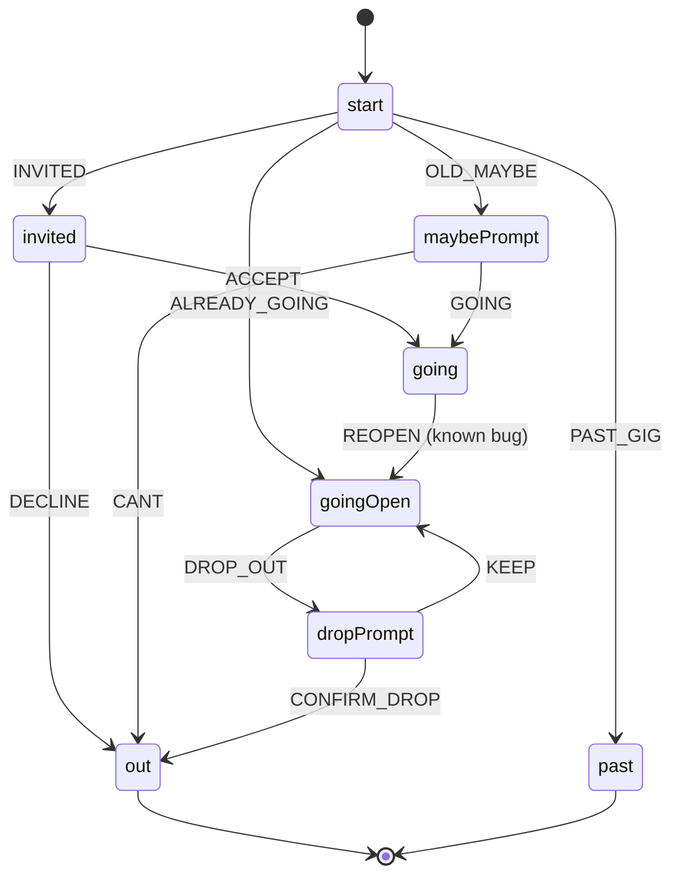

# RSVP (gig)

<!-- Generated by `pnpm e2e:models:docs` from the model `rsvp-gig` in e2e/models. Do not edit by hand. -->

A member answers a band gig invitation, changes the answer, and a past gig is read-only.

Starts as **member**. States 8/8 and transitions 11/12 covered by 8 generated paths (9 Playwright tests).

## States

| State | The user sees |
| --- | --- |
| `start` | Nothing open yet: the first event seeds the demo data and opens the app. |
| `invited` | "Your RSVP · Are you in?" with ACCEPT and DECLINE, and no Maybe. *(EventDetail.tsx showRsvpCard)* |
| `maybePrompt` | "Your answer was Maybe. Choose GOING or CAN'T." with GOING and CAN'T, neither chosen, no Maybe. *(EventDetail.tsx showGigMaybeRsvp; RsvpChoiceCard.tsx)* |
| `going` | The gig closes with "You're confirmed!", stays on the calendar, and the answer is saved as confirmed. *(AuthenticatedApp.tsx handleEventAccept)* |
| `goingOpen` | No ACCEPT / GOING any more: DROP OUT and EVENT CHAT. *(EventDetail.tsx member view (accepted gig))* |
| `dropPrompt` | "Drop out?" with Confirm drop and CANCEL. |
| `out` | The gig closes with "You dropped out of this event.", leaves the member's calendar, and the answer is saved as declined. *(AuthenticatedApp.tsx handleEventDecline; eventVisibility.ts canSeeEvent)* |
| `past` | A past gig with an unanswered invite: no ACCEPT / DECLINE / GOING / CAN'T, only VIEW SETLIST and EVENT CHAT. *(EventDetail.tsx isPast branches)* |

## Events

| Event | The user does |
| --- | --- |
| `INVITED` | The member's answer to "Client A — Wedding" is pending; open it from the calendar. |
| `OLD_MAYBE` | The member's answer to "Client A — Wedding" is a legacy "maybe"; open it. |
| `ALREADY_GOING` | The member already said yes to "Client A — Wedding"; open it. |
| `PAST_GIG` | The member's answer to the past "Summer Fest Opening" is pending; open it. |
| `ACCEPT` | Tap ACCEPT. |
| `DECLINE` | Tap DECLINE. |
| `GOING` | Tap GOING. |
| `CANT` | Tap CAN'T. |
| `REOPEN` | Open the gig again from the calendar. |
| `DROP_OUT` | Tap DROP OUT. |
| `CONFIRM_DROP` | Tap Confirm drop. |
| `KEEP` | Tap CANCEL next to "Drop out?". |

## Generated paths

| Test | Profiles |
| --- | --- |
| RSVP (gig): ALREADY_GOING → DROP_OUT → CONFIRM_DROP | phone-portrait, ipad-landscape, duo-laptop |
| RSVP (gig): ALREADY_GOING → DROP_OUT → KEEP | phone-portrait |
| RSVP (gig): INVITED → ACCEPT | phone-portrait |
| RSVP (gig): INVITED → ACCEPT → REOPEN **(known bug: not run)** | phone-portrait |
| RSVP (gig): INVITED → DECLINE | phone-portrait |
| RSVP (gig): OLD_MAYBE → CANT | phone-portrait |
| RSVP (gig): OLD_MAYBE → GOING | phone-portrait |
| RSVP (gig): PAST_GIG | phone-portrait |

## Known bugs

- **INVITED ACCEPT REOPEN** — member, phone-portrait
  - Actual: After ACCEPT the gig closes ("You're confirmed!"). Opening it again right away (within ~3 s) shows it with DROP OUT, then it closes by itself; the same happens to any event opened in that window.
  - Expected: An event the user opened stays open until they leave it. The stale close comes from EventDetail.tsx:791-797 (handleAccept calls onCloseProp() after awaiting onAccept), and DECLINE has the same shape (EventDetail.tsx:806-812).
  - Evidence: `e2e/.results-known-bugs/rsvp-gig-reopen-after-accept/ (trace.zip, test-failed-1.png)` (local, re-create with `E2E_KNOWN_BUGS=1`)
