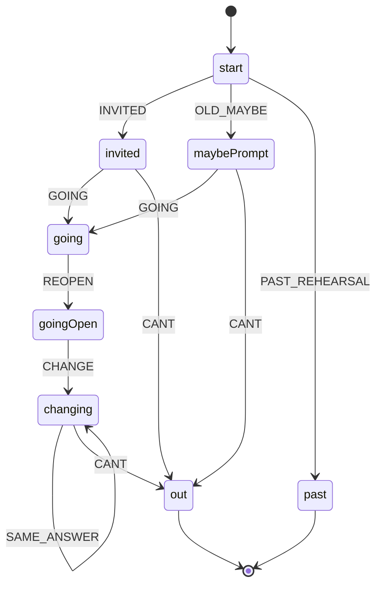

# RSVP (rehearsal)

<!-- Generated by `pnpm e2e:models:docs` from the model `rsvp-rehearsal` in e2e/models. Do not edit by hand. -->

A member answers a rehearsal, changes the answer, and a past rehearsal is read-only.

Starts as **member**. States 8/8 and transitions 11/11 covered by 6 generated paths (8 Playwright tests).

## States

| State | The user sees |
| --- | --- |
| `start` | Nothing open yet: the first event seeds the demo data and opens the app. |
| `invited` | "Your RSVP · Are you coming?" with GOING and CAN'T (neither chosen), the "Answer by" line, no Maybe. *(RsvpChoiceCard.tsx; EventDetail.tsx showRehearsalRsvp)* |
| `maybePrompt` | "Your answer was Maybe. Choose GOING or CAN'T." with GOING and CAN'T, neither chosen, no Maybe. *(RsvpChoiceCard.tsx)* |
| `going` | The rehearsal closes with "You're confirmed!", stays on the calendar, and the answer is saved as confirmed. *(AuthenticatedApp.tsx handleEventAccept)* |
| `goingOpen` | The RSVP is one line: "Your RSVP · Going" with Change. *(RsvpChoiceCard.tsx (answered))* |
| `changing` | GOING (chosen) and CAN'T again. *(RsvpChoiceCard.tsx (editing))* |
| `out` | The rehearsal closes with "You dropped out of this event.", leaves the member's calendar, and the answer is saved as declined. *(AuthenticatedApp.tsx handleEventDecline; eventVisibility.ts canSeeEvent)* |
| `past` | A past rehearsal with an unanswered invite: no GOING / CAN'T. *(EventDetail.tsx showRehearsalRsvp needs !isPast)* |

## Events

| Event | The user does |
| --- | --- |
| `INVITED` | The member's answer to "Weekly rehearsal" is pending; open it from the calendar. |
| `OLD_MAYBE` | The member's answer to "Weekly rehearsal" is a legacy "maybe"; open it. |
| `PAST_REHEARSAL` | "Weekly rehearsal" was two days ago and the member never answered; open it. |
| `GOING` | Tap GOING. |
| `CANT` | Tap CAN'T. |
| `REOPEN` | Open the rehearsal again from the calendar. |
| `CHANGE` | Tap Change. |
| `SAME_ANSWER` | Tap GOING (already the answer): nothing is saved again. |

## Generated paths

| Test | Profiles |
| --- | --- |
| RSVP (rehearsal): INVITED → CANT | phone-portrait |
| RSVP (rehearsal): INVITED → GOING → REOPEN → CHANGE → CANT | phone-portrait, ipad-landscape, duo-laptop |
| RSVP (rehearsal): INVITED → GOING → REOPEN → CHANGE → SAME_ANSWER | phone-portrait |
| RSVP (rehearsal): OLD_MAYBE → CANT | phone-portrait |
| RSVP (rehearsal): OLD_MAYBE → GOING | phone-portrait |
| RSVP (rehearsal): PAST_REHEARSAL | phone-portrait |
