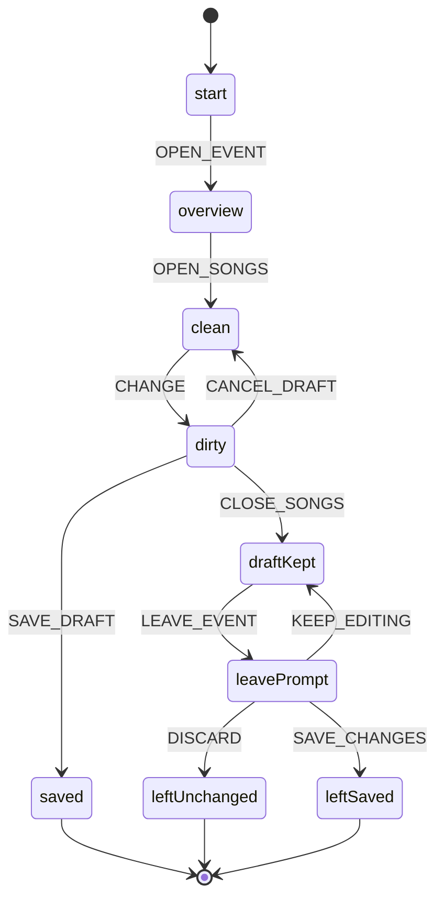

# Setlist draft

<!-- Generated by `pnpm e2e:models:docs` from the model `setlist-draft` in e2e/models. Do not edit by hand. -->

An admin changes a gig setlist or rehearsal focus songs, then cancels, saves, or leaves the event.

Starts as **admin**. States 9/9 and transitions 10/10 covered by 5 generated paths (5 Playwright tests).

Runs for each of: gig setlist, focus songs.

## States

| State | The user sees |
| --- | --- |
| `start` | Home. |
| `overview` | The event overview with its songs. |
| `clean` | The song editor with the saved songs and no "Unsaved changes" bar. |
| `dirty` | "Unsaved changes" with Cancel and Save; the template's songs are listed. *(UnsavedChanges.tsx UnsavedChangesBar)* |
| `draftKept` | The overview with "Unsaved changes" Cancel / Save: the draft is kept. *(EventDetail.tsx: setlistDraft.dirty && activeSheet !== 'setlist')* |
| `leavePrompt` | "Save the setlist changes?" with Save changes, Discard and Keep editing. *(EventDetail.tsx guardUnsaved)* |
| `saved` | No bar; the database holds the template's songs. |
| `leftUnchanged` | The event closes; the database still holds the old songs. |
| `leftSaved` | The event closes; the database holds the template's songs. |

## Events

| Event | The user does |
| --- | --- |
| `OPEN_EVENT` | Open Rooftop Session (gig setlist) or Weekly rehearsal (focus songs). |
| `OPEN_SONGS` | Gig: show the setlist (inline on phones, its tab on tablets). Rehearsal: EDIT on FOCUS SONGS. |
| `CHANGE` | Load a setlist template. |
| `CANCEL_DRAFT` | Tap Cancel on the "Unsaved changes" bar. |
| `SAVE_DRAFT` | Tap Save on the "Unsaved changes" bar. |
| `CLOSE_SONGS` | Rehearsal: close the focus songs sheet with its ✕. Gig: nothing (the setlist is part of the overview). |
| `LEAVE_EVENT` | Tap the event's Back. |
| `KEEP_EDITING` | Tap Keep editing. |
| `DISCARD` | Tap Discard. |
| `SAVE_CHANGES` | Tap Save changes. |

## Generated paths

| Test | Profiles | Variants |
| --- | --- | --- |
| Setlist draft: OPEN_EVENT → OPEN_SONGS → CHANGE → CANCEL_DRAFT | phone-portrait | gig setlist, focus songs |
| Setlist draft: OPEN_EVENT → OPEN_SONGS → CHANGE → CLOSE_SONGS → LEAVE_EVENT → DISCARD | phone-portrait | gig setlist, focus songs |
| Setlist draft: OPEN_EVENT → OPEN_SONGS → CHANGE → CLOSE_SONGS → LEAVE_EVENT → KEEP_EDITING | phone-portrait | gig setlist, focus songs |
| Setlist draft: OPEN_EVENT → OPEN_SONGS → CHANGE → CLOSE_SONGS → LEAVE_EVENT → SAVE_CHANGES | phone-portrait | gig setlist, focus songs |
| Setlist draft: OPEN_EVENT → OPEN_SONGS → CHANGE → SAVE_DRAFT | phone-portrait | gig setlist, focus songs |
