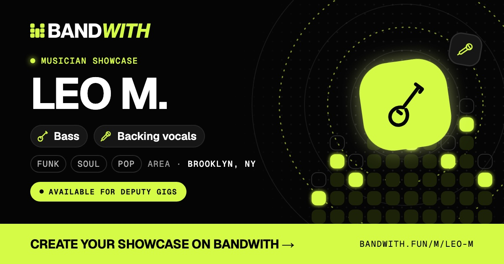
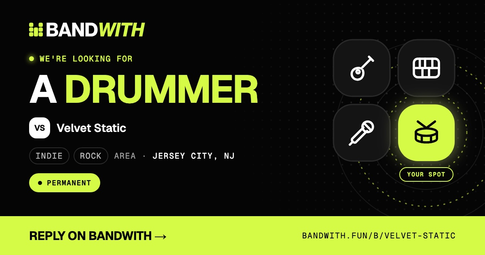

# Find musicians: a community where musicians and bands find each other

Status: **plan only, no product code.** Written 2026-11-20, on top of `main` 2a712d8.
The direction was agreed with the owner in a brainstorm on 2026-11-20 (answers quoted in §2).
This file holds no prices, plan limits or business numbers. Those stay in the local pricing notes and in the database.

Contents

1. Summary
2. Decisions taken with the owner
3. What exists today (the plan builds on it)
4. Product
5. Messaging: request → accept / decline / block / report
6. Privacy, safety and legal
7. Growing from zero users
8. Branded share cards
9. Where it lives: app and site
10. Data model sketch
11. Costs on the current plans
12. MVP and later phases
13. Prerequisites before opening it to the public
14. How we measure it
15. Risks
16. Open questions
17. Competitors checked

---

## 1. Summary

- **Find musicians** ("Trova musicisti", "Buscar músicos") lets a musician without a band, or a band looking for someone, find each other by distance from where they live.
- Every contact starts as a **request with a message**. The other person can **accept** (a direct chat opens), **decline** (quietly) or **block and report**.
- Musicians get a **showcase**: a profile that is useful on its own. It has a shareable link, and bands searching for a deputy or a new member inside BandWith find it.
- Bands publish a **"We're looking for X"** ad: permanent, deputy, or both. They can search the community from **Find a deputy** and from the members and lineup screens.
- **It sells BandWith by what happens after the match.**
  - An accepted deputy request makes the musician a linked deputy, confirmed in the app, who gets that gig's communications.
  - An accepted member request ends in **Invite to the band**, and the musician becomes a full member.
  - A musician who finds other musicians creates the band in BandWith.
- **Free, open everywhere, no pilot zone.** The product has to be worth using with zero users nearby. It does that through:
  - showcases that work alone;
  - shareable ad cards that use the existing Facebook and WhatsApp groups to reach people;
  - honest empty states;
  - saved searches with alerts;
  - growth from deputy requests that bands already send.
- **Branded share cards.** Every showcase and ad shared outside BandWith carries a recognisable BandWith card: a dynamic link preview, plus Story and square images to download. The cards show only public fields and always carry a "Create your showcase" or "Reply on BandWith" call to action (§8).
- **The existing direct deputy invite does not change.** It is the claim link sent by WhatsApp, SMS or email to someone the band knows. The community is one more source of deputies. The only change to the invite is an optional one-line "create your showcase" hint.
- Members are 18 or older. Locations are approximate, and nobody's contact details are ever shown. Profiles are private until the person turns visibility on.

## 2. Decisions taken with the owner

| # | Question | Owner's answer (2026-11-20) | What it means here |
|---|---|---|---|
| 1 | Where it lives | "app+pagina web ma in app si puo attivare come funzione: trova un sostituto e, se accetta, si conferma in app e riceve poi le comunicazioni se chiamato in causa" | All of it is in the app; the site has a public page plus showcase pages (§9). Find a deputy feeds into it (§4.4). |
| 2 | Minimum age | 18+ | Age gate at opt-in (§6.3). |
| 3 | Who can write to whom | Everyone, through a request | Anyone can send a request; there are limits and a required message (§5). |
| 4 | Pilot zone | "le community non devono essere un limite iniziale … trovare la soluzione anche con 0 utenti … per i singoli musicisti diventa anche una vetrina" | Open everywhere from day one; the cold start is solved by the product itself (§7). |
| 5 | Showcase on Google | OK to the recommendation | The link can always be shared; Google indexing is a separate opt-in, **off by default**. |
| 6 | Free dates visible to bands | OK to the recommendation | Only **free / busy** per date, never the reason or who the gig is with. |
| 7 | Showcase hint in deputy invites | OK to the recommendation | One optional line in the existing message; no new emails. |
| 8 | Name | OK to the recommendation | "Trova musicisti" / "Find musicians" / "Buscar músicos" (+ fr/de/pt in the app). |
| 9 | Direct deputy invite | "l'invito diretto ad un deputy rimane lo stesso, vero?" | **Yes, unchanged** (§4.4). |
| 10 | Bands looking for a new member | "se volessi (come band) cercare in questa community anche un nuovo membro … pure dovrebbe esserci" | **Yes**: ads and search cover **permanent / deputy / both** (§4.2, §4.5). |
| 11 | Branded sharing | "possiamo creare un design branded di bandwith customizzato (tipo social thumbnail picture per i link dei siti web) cosi da spingere il brand e renderlo riconoscibile?" | **Yes**: dynamic BandWith share cards for showcases and ads, link previews + Story/square images (§8). |
| 12 | Card font (2026-11-21) | "ok usa Geist per le card dinamiche" | Geist + Geist Mono for all community cards (§8.5). |
| 13 | Examples (2026-11-21) | "io vivo nella zona di new york e tu continui a usare riferimenti italiani" | Examples, demo data and units start from the New York area and English (miles in the US); other markets are translations, not the default. |
| 14 | Card visuals (2026-11-21) | "non usiamo foto di background: usa colore e illustrazioni cool, a tema, branded" | No photos on cards; colour + an illustration system built from the BandWith mark (§8.6). |

## 3. What exists today (the plan builds on it)

Checked on `main` 2a712d8.

- **Chat:** `chats` has `type chat_type` with `'direct'` already in the enum (002), plus `chat_participants` and `messages`. Community chats are direct chats with `band_id` null. Their RLS must be checked and extended for two people who share no band.
  - Sync is Realtime first: `src/lib/chatSync.ts` falls back to a 10 s poll only while the channel is down (#206, 758385f). Nothing to fix here.
- **Push and email:**
  - `send-push` sends pushes. BEFORE INSERT triggers (088–090) translate their text from `profiles.preferred_language`.
  - `send-email` sends email through Resend, from `noreply@bandwith.fun`.
- **Deputies:**
  - `band_deputies` (069) is the band's private list of people. `band_deputies.user_id` links a deputy to their account through the claim link `?deputy=<token>` (086).
  - `deputy_requests` (084) holds one request per gig and person, with its token. `/deputy.html` is the page where a deputy without an account answers. The **Deputy gigs** home serves accounts without a band, and deputy pushes are translated (088).
  - The UI is in `src/app/components/band/AskDeputySheet.tsx`, `DeputiesSection.tsx` and `src/app/components/deputy/*`. The lifecycle is in `docs/lifecycles/deputy.md`.
- **Instruments:** `src/lib/instruments.ts` has multilingual canonical keys (`bass`, `drums`, `keys`, …). It already matches deputies to the missing instrument (#84).
- **Band invitations:** `band_invitations` (007, admin policies 166) are email-based, with `pending | accepted | declined | expired`. A community member request gets turned into one server-side, so the band never sees the invitee's email.
- **Plan limits:** `plan_limits` and the plan guards (160–164, all off today) still apply when an accepted request adds a member or deputy. The community itself is never limited by plan.
- **Other things to reuse:**
  - `feature_flags` (130) for launching behind a switch.
  - `beta_waitlist` (128, retention 169).
  - The site in `site/` (EN/IT/ES, `src/content/features.ts`).
  - GA4, which is opt-in.

## 4. Product

### 4.1 Musician showcase

Off by default. The musician turns it on from their profile or from the "Find musicians" entry.

| Field | Notes |
|---|---|
| Display name | First name and last initial by default ("Leo M."), editable. |
| Photo | Optional; the existing avatar, shown inside the app only. **Never on share cards** (§8.3). |
| Instruments | Several, canonical keys from `instruments.ts`, one main. Free text allowed for instruments not in the list. |
| Genres | A closed list (translated) + one free tag. |
| Level | Hobby / semi-pro / pro. |
| Looking for | Any of: a permanent band, original project, covers / events, **deputy work**. |
| Availability | Evenings / weekends / rehearsals per week (rough), and, for deputy work, **free / busy per date** (§4.6). |
| Area | A town or postcode picked from a list, and the furthest the person will travel. Never a street (§6.1). |
| Links | 1–3 YouTube / SoundCloud / Spotify / Instagram links, shown as embeds or link cards. **No uploads**, so no storage cost. |
| Bio | Short, plain text, no links in the first version. |
| Public link | `bandwith.fun/m/<handle>`, shareable once the showcase is visible. Google indexing is a separate toggle, off by default. |

### 4.2 Band ad: "We're looking for X"

- It is created by a band admin from the band's settings or from the members screen. A band in the community **is** a BandWith band; a musician without one can create it in one step.
- **Fields:**
  - the instrument(s) wanted;
  - **permanent / deputy / both**;
  - genres;
  - level;
  - area (the band's town, approximate) and travel range;
  - a short text;
  - optionally the band's public links.
- **Status:** open / filled / closed. An ad closes by itself once the band fills it, or after a period of no activity. Stale ads are what people complain about in Facebook groups and classifieds.
- **Share card:** every ad has a ready-made image and text to share ("Velvet Static is looking for a bassist, Jersey City, NJ"). It links to a public page where the only action is "Reply in BandWith". The cards are designed in §8.

### 4.3 Search

- **Musician searching for bands:** by instrument wanted, permanent / deputy / both, distance, genre and level.
- **Band searching for musicians:** by instrument, **permanent / deputy / both**, distance, genre, level, and for deputies **free on a date**.
- Results are a list ordered by distance, then by real recent activity. Distances are rounded (§6.1). There is no map in the first version.
- **Honest empty state:**
  - "No drummer within 15 mi yet. The nearest is about 40 mi away." (miles in the US and UK, km elsewhere, from the device locale)
  - Then: widen the radius / save this search and we'll tell you / share your ad (with ready-made text).
  - Never fake or padded numbers.
- **Saved search with alert:** a push as soon as a match appears, and at most one email digest a week, which respects the Resend limits (§11).

### 4.4 Deputies: the existing flow, plus the community

**What stays exactly as it is:**
- The band's own deputy list (`band_deputies`).
- **Ask by WhatsApp / SMS / email** with the claim link.
- **Ask in the app** for linked deputies.
- `/deputy.html`, the Deputy gigs home, and the deputy pushes.

**What is added:**

1. **Find a deputy** (`AskDeputySheet`, opened when a member declines a gig) gets a third source under the band's list: **"Search the community"**.
   - It is pre-filled with the missing instrument (from the lineup role through `instruments.ts`), the gig date and the band's area.
   - It shows showcases marked "deputy work" that are **free** on that date.
2. **Request for this gig.** The request carries the gig's basics: date, town (not the street), role, and the fee if the admin chooses to show it.
   - It does **not** show the band's private data or anybody else's fee.
3. **The musician accepts.**
   - The person is added to `band_deputies` with `user_id` set, as if they had opened a claim link.
   - A `deputy_requests` row is created for the gig.
   - The musician confirms in the app (Yes / Not sure / No, the existing answers).
   - From then on they get **only the communications for the gigs they are called for**, through the existing deputy channels. The members-only privacy rules stay as they are: a deputy sees only their own fee and the logistics.
4. **One optional line in the existing invite message:** "Create your BandWith showcase so other bands can find you too."
   - It goes in the WhatsApp / SMS / email text the band already sends.
   - It sends no extra email.

### 4.5 New permanent member

- A band can search for **permanent** or **both**, from the community entry and from the **members screen** ("Looking for someone? Search the community").
- When a gig's lineup has a gap and the band has no deputy for that instrument, the lineup screen offers **"Search the community"** too.
- **Accepting a member request:**
  1. The chat shows the admin **Invite to the band**.
  2. A server-side RPC creates a `band_invitations` row for the musician's account, without exposing their email to the band.
  3. The musician accepts in the app and becomes a full member, with the normal roles and privacy rules.
  4. Plan limits on members apply as they do for any invite.
- A band can also invite a person as a deputy first and a member later. The chat keeps both buttons.

### 4.6 Free / busy dates

- **Who sets them:** the musician, by hand (tap dates as busy), plus, if they use BandWith, **automatically from their calendar**. A gig or rehearsal they are confirmed for, in their own band or as a deputy, makes that date busy.
- **What bands see:** free or busy per date, for deputy searches only. Never the reason, the band or the place.
- **Why it matters:** it is a reason for musicians to keep using BandWith even while they don't need a band.

### 4.7 After the match

- An accepted request opens a direct chat. The chat header carries the context: the ad, deputy for a gig, or member.
- **Actions in that chat:**
  - **Invite to the band**;
  - **Add as a deputy**;
  - **Ask for this gig**;
  - for a musician without a band, **Start a band with these people**. It creates the band and moves the people into a band chat.
- An "Invite your drummer / your band" link appears on the showcase and in chats.

## 5. Messaging: request → accept / decline / block / report

1. **Request**
   - A message of 20–500 characters is required. No links and no phone numbers or emails in the first message; they are detected and refused with a clear hint.
   - The context comes with it: ad, deputy for a date, or member.
2. **The recipient sees** who is writing (display name, instruments, rounded distance, level), the context and the message.
3. **Accept** opens a direct chat (`chats.type = 'direct'`).
4. **Decline** is quiet. The sender sees "Not available" and nothing more, and cannot send another request to that person for a cooling-off period.
5. **Pending requests** expire after a set time and show the sender "No answer".
6. **Block** works from a request, a chat or a showcase.
   - Neither person can find, see or message the other again, and any chat between them is hidden for both.
   - It is silent: the blocked person is not told.
7. **Report** works from a request, a chat, a showcase or an ad.
   - Reasons: spam, harassment, fake profile, under 18, other.
   - A report blocks automatically, and it goes into the moderation queue (§6.4).

**Anti-spam:**
- Only one open request per pair of people.
- A daily request limit per account. It is lower for new accounts and grows after accepted requests.
- An account needs a confirmed email to send.
- Server-side checks in the RPC, not just in the UI.
- An account is suspended automatically after several reports from different people, pending review.

## 6. Privacy, safety and legal

### 6.1 Location

- The person picks a town or postcode from a list, never a street address.
- **What we store:**
  - that town's centre, **snapped to a coarse grid** (about 2–3 mi / 3–5 km);
  - the town's name for display.
- **What we show:**
  - distances in rounded bands, in the viewer's unit: "< 3 mi", "~5 mi", "~15 mi", "~30 mi", "30+ mi" (or "< 5 km" … "50+ km"). Stored in km, shown in miles for US/UK locales;
  - the town name.
- The grid plus the rounding stops anyone working out a home position by searching from several places.
- No GPS. If a "use my position" helper is added later, it only picks the nearest town on the device and never sends coordinates.

### 6.2 Visibility and data

- **Who sees what:**
  - Nothing is visible until the person turns it on.
  - Showcases and ads are visible **to signed-in users** inside the app.
  - On the web, only through the share link, and on Google only after the separate indexing opt-in.
- **Never shown:** the email, the phone number, the exact area, or which bands someone plays in (unless they choose to list them).
- **Inactive profiles** are hidden after a period with no real activity. "Active this week" is based on real app use, not log-ins faked by the system.
- **GDPR:**
  - explicit consent to publish;
  - the person can turn it off at any time (hidden at once);
  - deleting the account removes the showcase, ads, requests and community chats (cascade);
  - data export follows the existing account export, if there is one, or it is added.
  - Data is hosted in the US (Supabase, Oregon), so the Privacy Policy must say so.
- **Not readable by anon:**
  - community tables are not granted to `anon` (rule since 100/101);
  - public showcase pages are served by a function that returns only the public fields of visible, link-enabled profiles.

### 6.3 Age

- **18+ only.** The person enters a date of birth (self-declared) when turning the showcase on, and also to send or answer requests. Under 18 cannot turn it on.
- The date of birth is stored privately, only to enforce the rule, and is never shown.
- "Under 18" is a report reason; such an account is hidden at once, pending review.

### 6.4 Moderation for a one-person team

- **The design does most of the work:**
  - a request comes before any chat;
  - the first message is required and has no links;
  - there are limits, blocks and the 18+ rule.
- **Queue:**
  - Reports are stored, and the owner gets an email with a link to an admin-only review screen.
  - Actions: dismiss / hide the content / suspend the account, each with a short reason. The person concerned gets that reason, which is the DSA "statement of reasons".
  - Several reports from different people suspend the account automatically until review.
- **Contact:** a visible "Report a problem" address (an existing `@bandwith.fun` alias).

### 6.5 Legal and store rules

- **App Store Review Guideline 1.2 (user-generated content).** Apple requires a filter for objectionable content, reporting with a timely response, blocking of abusive users, and published contact information. Without these, the build is rejected. Google Play has an equivalent UGC policy.
- **EU Digital Services Act.** Any hosting service must have a notice-and-action mechanism and give a statement of reasons when it removes content. Small companies are exempt from the heavier duties, but not from these.
- **Terms and Privacy Policy** must cover user content, moderation, the age rule, approximate location and the US hosting. They also need the operator update, which is still postponed: it is selling as an individual.
- Not legal advice: the Terms and Privacy text gets a check before the public launch.

## 7. Growing from zero users

The owner's rule: no pilot zone. The community is a product, so it has to be convincing with nobody nearby. That works on two principles: **it is useful when you are alone**, and **every action creates a link that brings someone else in**.

1. **A showcase that is useful alone.** It is a clean musician card with a link, for an Instagram bio, a WhatsApp status or a reply in a Facebook group. Its value doesn't depend on other users. Every share is an ad for BandWith, through the branded card in §8.
2. **Ad share cards.** A band's "looking for a bassist" goes where musicians already are (Facebook groups, Instagram, WhatsApp, classifieds), and the replies come back into BandWith. We use the existing groups to reach people, we don't compete with them, and we never scrape them. The branded card (§8) makes every post recognisably BandWith.
3. **Honest empty states.** Tell people the truth, offer the nearest result, a wider radius, a saved search and a share. A useful empty screen keeps the person. A fake count loses their trust, which is BandMix's most common complaint.
4. **Saved searches with alerts.** They turn "nobody yet" into "we'll tell you", and every new showcase can wake someone up.
5. **Growth from deputy requests that bands already send.**
   - Every claim link a band sends goes to a real, known musician; it also carries the one-line showcase hint (§4.4).
   - Deputies who accept become showcases. This grows wherever BandWith bands already play.
6. **Bands already in BandWith.**
   - "Search the community" appears at the moment of need: a member declines, or the lineup has a gap.
   - With no results, the same sheet offers to share an ad card, so the need itself recruits.
7. **Invites everywhere.** Invite your drummer, invite your band, and create the band from a group of matches.
8. **Content and the site.**
   - A "Find musicians" page on bandwith.fun, in EN, IT and ES.
   - Later, city × instrument pages ("drummer wanted in Brooklyn", "bass player Jersey City", and the same in IT/ES for those markets), but only where enough real, indexable showcases exist. Empty pages are thin content and hurt the brand.
   - The social video series can carry a "find a deputy in two minutes" episode.
9. **The beta waitlist and the Mirage network.**
   - One announcement to the waitlist, phrased as an opt-in ("turn on your showcase"), sent only after the Terms and Privacy update.
   - Mirage Music and its deputies are the first real showcases and the first real ads, with their consent.
10. **Brand fit.** It stays a tool for working bands, not a social network: no feed, likes, followers or public comments. Showcases, ads, requests and then the band in BandWith.

## 8. Branded share cards

The owner asked for this on 2026-11-20: whatever people share from the community should carry a custom BandWith design, like a social thumbnail for a link, so the brand gets pushed and becomes recognisable.

Every shared link is an ad for BandWith. The card is what people see in WhatsApp, Facebook, X, LinkedIn and iMessage before they tap.

### 8.1 Mockups

These use fake demo data in English: the site's persona Leo M. (Brooklyn, NY) and the demo band Velvet Static (Jersey City, NJ). They are rendered with the #248 share-card style, in Geist (§8.5), with no photos: colour and branded illustrations only (§8.6).

| Musician showcase, link preview 1200×630 | Band ad, link preview 1200×630 |
|---|---|
|  |  |

Showcase as a Story, 1080×1920: [`community/03-showcase-story-1080x1920.jpg`](community/03-showcase-story-1080x1920.jpg).

### 8.2 Which cards

| Card | Shared from | Link | CTA on the card |
|---|---|---|---|
| **Musician showcase** | the showcase (app) and its public page | `bandwith.fun/m/<handle>` | "Create your showcase on BandWith" |
| **Band ad** ("We're looking for X") | the ad (app), Find a deputy / members with no results, the public ad page | `bandwith.fun/b/<band-slug>` (the band's open ads; `?a=<code>` picks one) | "Reply on BandWith" |
| **"Found my band"** (phase 2) | offered to both people after an accepted member invite | the band's public page or the BandWith home | "Find your band on BandWith" |

- A deputy request for a specific gig is private and **never** gets a card.
- The "found my band" card names both the person and the band, so it is made only if **both** say yes, each on their own device.

### 8.3 Dynamic data: only public fields

**What can appear on a card:**

| Data | Showcase | Band ad | Rule |
|---|---|---|---|
| Display or stage name | ✓ | — | As shown on the showcase ("Leo M." by default). Long names step the font size down; two lines at most. |
| Instruments with the instrument icons | up to 2 + "+N" | the wanted instrument, as a large icon | Canonical keys from `instruments.ts`; the icons are the site's `public/icons/instrument-*.svg` set. |
| Genres | up to 3 | up to 3 | From the closed list, translated. |
| City | ✓ | ✓ | The town label only. **Never a distance, a postcode or a grid cell.** |
| Status pill | "Available for deputy work" (if on) | "Permanent" / "Deputy" / "Permanent or deputy" | |
| Band name and logo | — | ✓ (`bands.logo_url`, initials if none) | The ad is public by the admin's choice. |
| Short URL + BandWith logo | ✓ | ✓ | Logo always top left; URL always in the lime bar. |

**Never on a card:** photos (of the person or as a background; the owner decided on 2026-11-21 that cards are colour + branded illustrations only), phone, email, exact or approximate position, distance, fees, dates or free/busy, the level (it can read as a judgement), and the bands someone plays in.
- **Why so strict:** once a card has been shared, the image stays in other people's chats and in WhatsApp's or Facebook's caches. Hiding the showcase later cannot take it back. Only fields the person already made public go on it.

### 8.4 Formats

| Format | Size | Used for | How it is delivered |
|---|---|---|---|
| Link preview (OG + Twitter `summary_large_image`) | 1200×630 | WhatsApp, Facebook, X, LinkedIn, iMessage, Telegram | `og:image` / `twitter:image` on the public page; the platforms fetch it themselves |
| Story | 1080×1920 | Instagram and Facebook Stories, WhatsApp status | "Download image / Share" button |
| Square | 1080×1080 | Instagram feed, groups | "Download image / Share" button |

- **Instagram Stories don't show link previews.** That is why the Story and square images are offered as files to share. The person adds Instagram's own link sticker, and the card shows the short URL as text in case they don't.
- **Story layout:** the top ~250 px and bottom ~340 px stay free of important content, because the Instagram and WhatsApp interface covers them.
- **Sharing:**
  - In the app, the native share sheet (`@capacitor/share`, already a dependency), with the image file and the link.
  - On the web, the Web Share API with the file where the browser supports it, otherwise a plain download.
- **Text:** "Download image" saves the card. "Share" sends the card and the link, with a short text in the person's language: "My musician showcase on BandWith: bandwith.fun/m/leo-m".

### 8.5 How it is built

- **Generated on the server, on demand, then cached.** It is not generated in the browser, so every platform's crawler gets the same image.
  - **Recommended:** a Vercel function on the **site project** (`site/api/`, next to `geo.js`), using `@vercel/og` (Satori + resvg): JSX-like layout → PNG, about 1 s cold, cheap.
  - **Alternative:** a Supabase edge function (also Satori). It would add egress on the plan we are trying to protect, so the site project is the better host.
- **Data:** one `SECURITY DEFINER` RPC granted to `anon`, the same pattern as the quote-link RPCs (099):
  - `bw_community_public_card(kind, key)` returns **only** the public fields in §8.3;
  - only for showcases or ads that are visible and have their link enabled;
  - otherwise it returns nothing.
  - The public pages use the same RPC.
- **Cache and refresh:**
  - The image URL carries a version, the hash of the public fields + `updated_at` + language: `/api/card/m/leo-m.png?v=3f9a&lang=en`.
  - The page's `og:image` always points at the current version, so editing the showcase produces a new image.
  - The CDN caches each version for a long time (`s-maxage` + `stale-while-revalidate`).
  - Platforms keep their own copy. Facebook's Sharing Debugger can refresh it for a test, but we can't force it for people.
- **Fallback:**
  - If the profile is hidden or deleted, or rendering fails, the endpoint returns a **static card** for that kind and language: "Find musicians near you · BandWith".
  - The static cards are built once with the existing `site/tools/og-cards.mjs` pipeline (#248).
  - The page never has a broken or empty preview.
- **Languages:**
  - The card follows the page language: `/m/leo-m`, `/it/m/leo-m`, `/es/m/leo-m`.
  - When shared from the app, it follows the app language, mapped to EN/IT/ES for the site. Other app languages fall back to EN until the site has them.
  - Instruments and genres come from the same dictionaries as the app and the site (`instruments.ts` labels, the site's `dict/*.json`).
- **Fonts (decided by the owner on 2026-11-21: Geist):**
  - The #248 cards render the display face (`neue-haas-grotesk-display`) through Adobe Fonts in a browser at build time. An on-demand server renderer needs the font files themselves, and the Adobe Fonts licence does not let us put those files on a server.
  - So the community cards use **Geist** (OFL, by Vercel): Geist Bold / SemiBold for the big uppercase lines and chips, and **Geist Mono** for the labels, the pill and the URL. Geist Mono is already self-hosted on the site.
  - The font files (`.ttf` / `.woff`, since Satori does not read `.woff2`) are bundled with the function.
  - The community's static fallbacks use Geist too, so every community card looks the same. The site's page cards from #248 stay as they are.
  - The logo is an SVG, so it is unaffected.
- **Illustrations instead of images:** the right side of every card is a vector illustration generated from the card's data (§8.6), so nothing is fetched, no photo is stored for cards, and Satori draws it as inline SVG.
- **Size and speed:** under ~300 KB per PNG (WhatsApp is picky with large previews). Satori gives JPEG-like sizes with flat colours, so this is easy.

### 8.6 Brand rules (so every card is recognisable)

They match the #248 site cards and the Lime/Ink rule:

- Ink background (`#050505`) with the soft lime glow in the top corner.
- **BandWith logo top left, always the same size and position.**
- A mono label in lime with the LED dot ("● MUSICIAN SHOWCASE", "● WE'RE LOOKING FOR").
- One big uppercase line: the name, or "A DRUMMER". On ads, the wanted instrument is in lime.
- Instrument chips with the icons; genres as outline chips in mono.
- One lime pill for the status.
- **A lime bar along the bottom with the CTA on the left and the short URL on the right**, in the same place on every card. That bar is the recognisable signature.
- **No photos, ever.** Colour and branded illustrations only (owner, 2026-11-21).
- **The illustration system** is built from the BandWith mark's own grammar, the rounded square (corner radius ≈ a third of its side), in Lime, Ink and white:
  - **instrument tile:** a big lime rounded square with the main instrument's icon in ink, tilted a few degrees, with a soft lime glow;
  - **block equalizer:** columns of rounded squares rising from the CTA bar like a VU meter, the top block of each column lit, plus one empty outline block above (the "room to grow");
  - **sound rings:** concentric circles around the tile, two of them dotted lime;
  - **dot matrix:** a fine dot texture fading out from the illustration's centre;
  - **lineup grid** (band ads): the band as a 2×2 grid of tiles, the instruments it has in dark tiles with white icons, and the missing one lit lime with rings and a "YOUR SPOT" label. A 3-piece looking for its 4th, or a duo looking for two (two lit tiles), reads at a glance.
  - A second instrument (if any) is a small dark tile with a lime icon, orbiting the main one.
- The illustration is chosen from the data (main instrument, the band's current instruments, the wanted one), so every card is different but always recognisably BandWith. Instruments without an icon use the "other" glyph.
- No other colours, no emoji, no user-chosen themes.

### 8.7 Growth and measurement

- **Every card has a CTA:** "Create your showcase on BandWith" on showcases, "Reply on BandWith" on ads. The public page repeats it as its only action.
- **Shared links carry UTM tags:** `utm_source=share`, `utm_medium=<whatsapp|instagram|copy|…>` when the share sheet tells us, and `utm_campaign=showcase|ad|found-band`. The page's canonical URL strips them.
- **What we count:**
  - **shares** — a GA4 event in the app (opt-in) and on the site (consent mode, as on bandwith.fun today);
  - **opens** — page views with those UTM tags;
  - **sign-ups and showcases created after an open** — the same UTM, kept through sign-up;
  - **replies to ads** that started from a shared link.
- **What we don't count:** image fetches. They are crawlers, not people, so they never count as opens.
- A share per person is never stored as a row. The counts are aggregated.

## 9. Where it lives: app and site

| | App (web, iOS, Android) | Site (bandwith.fun) |
|---|---|---|
| Showcase and ad editing | ✓ | — |
| Search, requests, chat, block, report | ✓ | — |
| Find a deputy / members / lineup entry points | ✓ | — |
| Public showcase page `/m/<handle>` (opt-in link) | opens in the app if installed | ✓ (public fields only, "Contact in BandWith", dynamic share card §8) |
| Public ad page (share card target) | opens in the app if installed | ✓ ("Reply in BandWith", dynamic share card §8) |
| Share card renderer (`site/api/`, `@vercel/og`) | uses it for "Download image / Share" | ✓ (§8.5) |
| "Find musicians" landing (EN/IT/ES) | — | ✓ |
| City × instrument pages | — | later (phase 3), only above a minimum of real profiles |

**Why:**
- The accounts, chat, push, blocking and the conversion into a band all live in the app.
- The site does what it does best: public pages that can be shared and found, with one call to action.
- Chat on the site would be a second messaging system to moderate.

## 10. Data model sketch

These are sketches, not final DDL. Use the next free migration block when work starts, and reserve it for this update; it is `170+` on `main` today, so check `supabase/migrations` and the open PRs first.
- Everything is additive.
- RLS is on for every table.
- Nothing is granted to `anon`; public pages read through a function that returns only the public fields of visible, link-enabled profiles.
- Each new readable column gets its own GRANT, under the column-grant rule.

**`community_profiles`** — a musician's showcase; one per user.
- `user_id` is the PK and references auth.users, `on delete cascade`.
- Fields:
  - `visible bool` (default false), `link_enabled bool`, `indexable bool` (default false), `handle` (unique);
  - `display_name`, `instruments text[]` (canonical keys), `main_instrument`, `genres text[]`, `genre_tag`, `level`;
  - `looking_for text[]` (`band`, `originals`, `covers`, `deputy`);
  - `area_label`, `area_cell` (the snapped grid cell, or lat/lng already rounded), `travel_km`;
  - `links jsonb` (max 3, validated URLs), `bio`;
  - `last_active_at`, `created_at`, `updated_at`.
- RLS: the owner reads and writes their row. Signed-in users read only through the search RPC.

**`community_private`** — data used only to enforce the rules.
- `user_id`, `birth_date`.
- Only the owner and the RPCs can read it.

**`community_band_ads`** — a band's "looking for".
- Fields:
  - `id`, `band_id`;
  - `instruments text[]`, `kind` (`permanent` | `deputy` | `both`), `genres`, `level`;
  - `area_label`, `area_cell`, `travel_km`, `body`;
  - `status` (`open` | `filled` | `closed`), `created_by`, `last_active_at`, timestamps.
- RLS: band admins write. Signed-in users read open ads through the search RPC.

**`community_busy_dates`** — the musician's busy dates, set by hand.
- `user_id`, `date`.
- Calendar-derived busy dates are computed in the RPC, not copied here.

**`community_requests`**
- Fields:
  - `id`, `from_user`, `to_user`;
  - `from_band_id` nullable (when a band admin writes as the band), `ad_id` nullable;
  - `context` (`ad` | `deputy` | `member` | `musician`), `event_id` nullable (deputy for a gig);
  - `message`, `status` (`pending` | `accepted` | `declined` | `expired` | `withdrawn`), `chat_id` nullable, timestamps.
- Constraint: one open request per (from, to).
- Inserts and updates happen **only through RPCs** (`bw_community_request`, `bw_community_answer`), which check the limits, blocks, the 18+ rule and the email confirmation.

**`community_blocks`**
- `blocker`, `blocked`, `created_at`, with a unique pair.
- Every search and request RPC excludes both directions.

**`community_reports`**
- `id`, `reporter`, `target_user`, `target_kind` + `target_id`, `reason`, `note`, `status`, `action`, `action_reason`, timestamps.
- Only admins of the platform read it.

**Search RPC `bw_community_search`**
- Inputs: the parameters (instrument keys, kind, radius band, date, genre, level), using the caller's own area from their profile or band.
- Steps:
  1. a bounding box on the grid cells;
  2. haversine distance;
  3. remove blocks, hidden or inactive profiles and the caller;
  4. rounded distance band, public fields only;
  5. limit and page.
- It needs no PostGIS or earthdistance; it can move to them later if the table grows large.

**When a request is accepted** (server-side):
- A direct chat is created (`chats.type = 'direct'`, `band_id` null, two participants).
- In the deputy case, a `band_deputies` row is linked (`user_id`) and a `deputy_requests` row is created for the gig.
- In the member case, a `band_invitations` row is created for the invitee's account.

**Pushes:**
- New request, accepted, a saved search matched, and a gig request.
- Translated by the existing trigger pattern (088–090), and they respect the notification preferences.

## 11. Costs on the current plans

- **Search** is one small RPC returning only a few columns, with no Realtime on the directory. Its egress is low.
- **Chats** use the existing Realtime-first sync (#206), so their cost grows with the messages sent, not with polling.
- **Showcases** have no uploads (links and embeds only) and reuse avatars. Storage does not change.
- **Email** for alerts is at most one digest a week per person; everything else goes by push. Sign-ups from community growth still cost 2 emails each, and Resend Free stops at 100 a day. The scaling plan (`docs/plans/scaling-and-costs.md`) already says to move to Resend Pro on days with a public push.
- **Public pages and share cards** are site pages and one image function on Vercel. They are cached per version on the CDN, so each card is rendered about once per change, not once per view. They read Supabase through one small RPC that returns a few public fields.
- **The real growth risk is the Free plan itself**: no backups, the pause after inactivity, and the egress ceiling. That is why Supabase Pro is a prerequisite (§13).

## 12. MVP and later phases

Every phase:
- ships behind a `feature_flags` switch (130) with a kill switch;
- follows the existing gates: failing-first tests, e2e on the 10 profiles, an XState lifecycle model, emulator passes including every Duo posture, axe, all app languages, Academy and handbook updates.
- Releases stay manual.

**Phase 1 — MVP**
- Musician showcase (opt-in, 18+, approximate area, links), with a public link page on the site.
- Band ad with **permanent / deputy / both**, and its public page.
- **Branded share cards (§8):** dynamic 1200×630 link previews for showcases and ads, Story 1080×1920 and square 1080×1080 through "Download image / Share", static fallbacks, EN/IT/ES, UTM on shared links.
- Search with the filters in §4.3, an honest empty state, and saved searches with push alerts.
- Request → accept / decline / block / report, then a direct chat.
- After a match: **Invite to the band**, **Add as a deputy**, **Ask for this gig** (the deputy flow in §4.4, steps 2–3).
- Entry points:
  - "Find musicians" in the app;
  - **Search the community** in Find a deputy;
  - the members screen and the lineup gap.
- The one-line showcase hint in the existing deputy invite.
- The moderation queue (email + admin screen), limits and auto-suspension.
- The "Find musicians" landing page on the site (EN/IT/ES).
- Academy articles, handbook pages, Terms and Privacy text.

**Phase 2**
- Free / busy dates from the calendar.
- The "Found my band" share card (§8.2), only with both people's consent.
- "Start a band with these people" from a group of matches.
- The weekly email digest for saved searches.
- Referral links with non-cash rewards. What the reward is gets decided then, with no numbers here.

**Phase 3**
- City × instrument pages on the site, only above a minimum of real, indexable showcases, in EN/IT/ES.
- An approximate map view on the grid cells.
- A "real, active band" badge from real activity.
- One-off ads ("bassist for one wedding on June 14").
- Recommendations ("3 new drummers near you").

## 13. Prerequisites before opening it to the public

1. **Supabase Pro**, with the spend cap on, before public growth. It brings backups, no pause, and much more egress (`docs/plans/scaling-and-costs.md` §5). The chat polling fix is **already done** (#206).
2. **Terms and Privacy Policy updated** for user content, moderation, 18+, approximate location, US hosting and the operator (§6.5).
3. **App Store 1.2 / Google Play UGC** requirements in place: filter, report, block and contact.
4. **Resend Pro on announcement days**, as the scaling plan already says.

## 14. How we measure it

The data is aggregated, from database queries and the existing opt-in GA4 events. Nothing is tracked per person outside the app's own data.

- **North star:** accepted requests per month that end up in BandWith: a member invite accepted, a deputy linked and confirmed for a gig, or a band created.
- **Funnel:**
  1. showcases and ads published;
  2. searches;
  3. searches with at least 3 results within 15 mi / 25 km (liquidity, per area);
  4. requests sent;
  5. % accepted;
  6. time to first answer;
  7. % that turn into a member, deputy or band.
- **Growth loops** (see §8.7 for how shares are counted):
  - shares of showcases and ads;
  - visits to the public pages, and sign-ups that start from them;
  - deputies who accepted a claim link and then turned on a showcase;
  - saved searches that sent an alert, and the requests that followed.
- **Business** (once paid plans are live): bands whose first member, deputy or creation came from the community, and how many of them are on a paid plan later.
- **Health:**
  - reports and blocks per 100 requests;
  - % of requests never answered;
  - visible showcases active in the last 30 days;
  - auto-suspensions overturned in review.

## 15. Risks

| Risk | Mitigation |
|---|---|
| Empty community: searches with no results | Showcases that work alone, share cards, honest empty states, saved searches with alerts, growth from deputy invites (§7) |
| Spam or harassment, with one person moderating | Request first, required message with no links, limits, block, report with auto-block, auto-suspension, 18+ |
| Ghost profiles (the competitors' main flaw) | Hide after inactivity, "active" based on real use, ads close themselves |
| Location privacy | Town only, snapped grid, rounded distances, no GPS |
| Store rejection | App Store 1.2 / Play UGC checklist in the MVP |
| Costs at growth | Supabase Pro before opening, Realtime chats (done), no uploads, push before email |
| Brand drift into a social network | No feed, likes or followers; every screen leads to a band, a gig or a deputy |
| Legal | Terms and Privacy update + DSA notice and action before public launch |

## 16. Open questions

- The grid size (2–3 mi / 3–5 km) and the distance bands: to confirm on real towns, starting with the New York area (dense boroughs vs. suburban NJ/Long Island), then Europe.
- Whether a band admin writes as themself or as the band, and how replies to the band are shared among admins.
- The inactivity period before a showcase hides, the request expiry, the cooling-off period after a decline, and the daily limits. These are product values, to set in the database at build time.
- Whether the fee is shown in a community deputy request, or only after the musician accepts.
- Which of the existing languages the public site pages need beyond EN/IT/ES.
- Whether "Download image" adds a small QR code to the Story and square images, for people who see them without a tappable link.

## 17. Competitors checked

Brief scan, 2026-11-20 (Trustpilot, App Store reviews, guides). These are user reviews, not verified facts.

- **BandMix**:
  - messaging needs a paid plan, and often the person receiving cannot reply;
  - profiles shown as "active" that never answer;
  - complaints about renewals and cancelling.
- **Vampr**:
  - floods of connection requests with no message and no way to ignore or decline;
  - dormant accounts are never removed;
  - messaging is rated poorly.
- **Bandmates and similar apps**: private messages need a paid plan; some paying users report months without an answer.
- **"Join My Band"**: not found as an active product.
- **Craigslist "musicians" section** (the US default): plain text ads with no profiles, no samples to listen to and no verification; scammers and spam are common, and contact goes through an anonymous email relay with no accept/decline. (From general knowledge, not checked in this scan.)
- **Local Facebook groups and classifieds** (also checked for Italy: Subito, Musicofili, Mercatino Musicale, Villaggio Musicale):
  - old ads that are never closed;
  - no filter by distance or instrument;
  - phone numbers in plain text;
  - no verification.
- **The gap:** all of them stop at the match. Nobody helps with what comes next (rehearsals, gigs, deputies, getting paid), which is what BandWith already does. This plan's advantages are free messaging, a request before any chat, no ghost profiles, approximate location, and one tap from a match into a band.

Sources: [BandMix on Trustpilot](https://www.trustpilot.com/review/www.bandmix.com?page=4), [Vampr reviews](https://justuseapp.com/en/app/1069819177/vampr-find-meet-musicians/reviews), [Bandmates on the App Store](https://apps.apple.com/app/id1465299575), [Aranzulla: siti per cercare musicisti](https://www.aranzulla.it/siti-per-cercare-musicisti-1452368.html).
