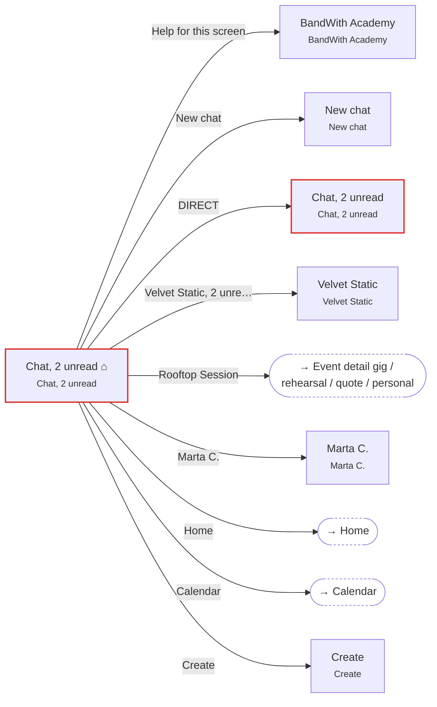
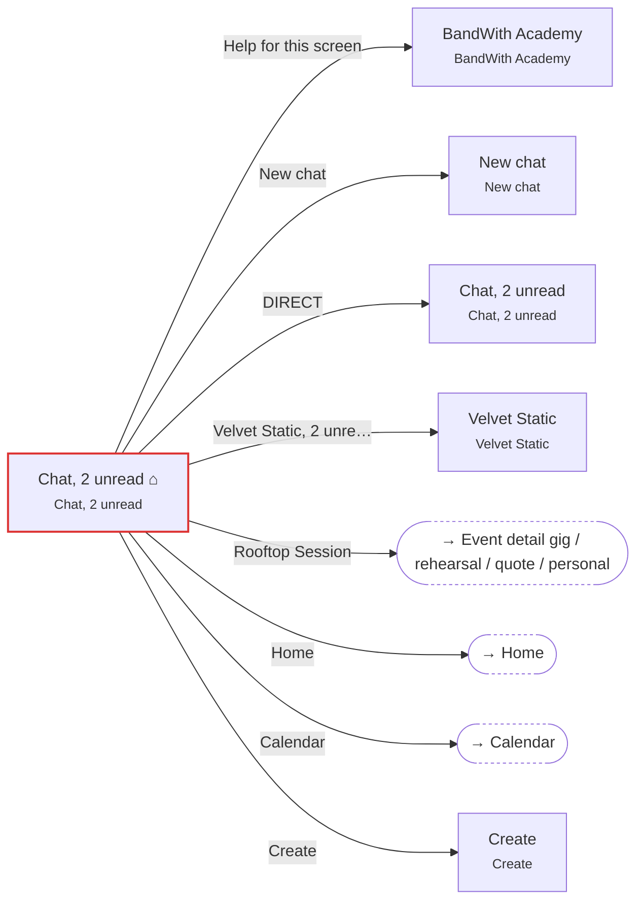

# Chat

[← Screen map](README.md) · profile phone-portrait

## admin (7 screens)

_Leo M., admin of the demo band Velvet Static_ · source: [chat.admin.mmd](chat.admin.mmd)

## member (6 screens)

_Leo M. as a member of Velvet Static (not admin)_ · source: [chat.member.mmd](chat.member.mmd)

