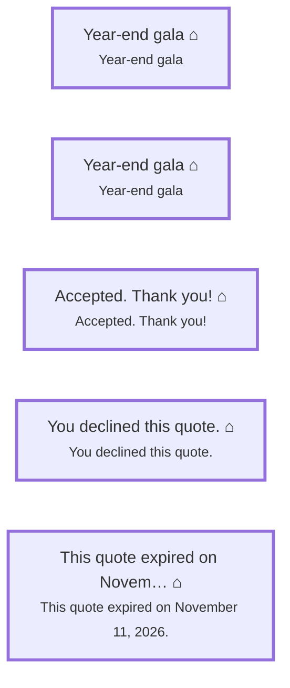

# Client quote page

[← Screen map](README.md) · profile phone-portrait

## client (5 screens)

_The band's client on the public /quote.html page (demo token)_ · source: [client.client.mmd](client.client.mmd)

