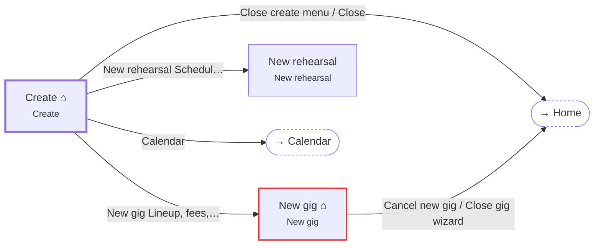
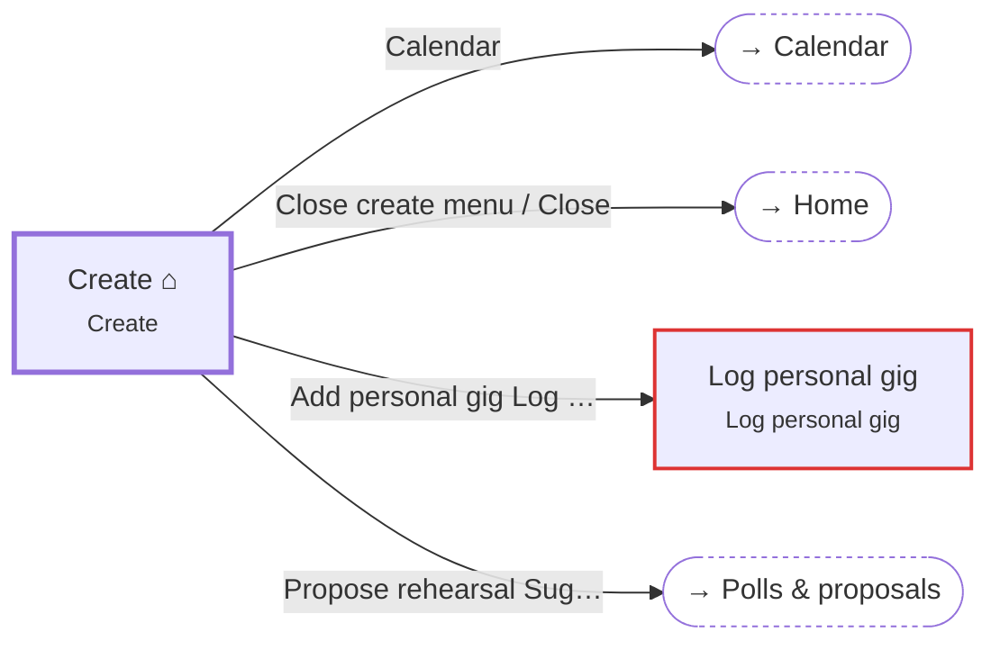

# Create

[← Screen map](README.md) · profile phone-portrait

## admin (3 screens)

_Leo M., admin of the demo band Velvet Static_ · source: [create.admin.mmd](create.admin.mmd)

## member (2 screens)

_Leo M. as a member of Velvet Static (not admin)_ · source: [create.member.mmd](create.member.mmd)

