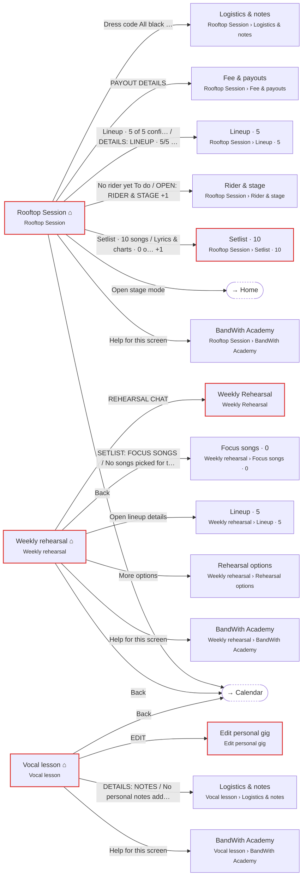

# Event detail (gig / rehearsal / quote / personal)

[← Screen map](README.md) · profile phone-portrait

## admin (39 screens)

_Leo M., admin of the demo band Velvet Static_ · source: [event.admin.mmd](event.admin.mmd)

```mermaid
flowchart LR
  s0["Rooftop Session ⌂<br/><small>Rooftop Session</small>"]
  s1["Weekly rehearsal ⌂<br/><small>Weekly rehearsal</small>"]
  s2["Jazz Club Night ⌂<br/><small>Jazz Club Night</small>"]
  s3["Quotes ⌂<br/><small>Quotes</small>"]
  s4["Vocal lesson ⌂<br/><small>Vocal lesson</small>"]
  s5["BandWith Academy<br/><small>Rooftop Session › BandWith Academy</small>"]
  s6["Title, date & times<br/><small>Rooftop Session › Title, date & tim…</small>"]
  s7["Venue & location<br/><small>Rooftop Session › Venue & location</small>"]
  s8["Setlist · 10<br/><small>Rooftop Session › Setlist · 10</small>"]
  s9["Rider & stage<br/><small>Rooftop Session › Rider & stage</small>"]
  s10["Lineup · 5<br/><small>Rooftop Session › Lineup · 5</small>"]
  s11["Kit for this gig<br/><small>Rooftop Session › Kit for this gig</small>"]
  s12["Edit fee<br/><small>Rooftop Session › Edit fee</small>"]
  s13["Fee & payouts<br/><small>Rooftop Session › Fee & payouts</small>"]
  s14["Lineup<br/><small>Rooftop Session › Lineup</small>"]
  s15["Which set?<br/><small>Rooftop Session › Which set?</small>"]
  s16["Tasks<br/><small>Rooftop Session › Tasks</small>"]
  s17["Logistics & notes<br/><small>Rooftop Session › Logistics & notes</small>"]
  s18["BandWith Academy<br/><small>Weekly rehearsal › BandWith Academy</small>"]
  s19["Title, date & times<br/><small>Weekly rehearsal › Title, date & tim…</small>"]
  s20["Venue & location<br/><small>Weekly rehearsal › Venue & location</small>"]
  s21["Band roster<br/><small>Weekly rehearsal › Band roster</small>"]
  s22["Lineup · 5<br/><small>Weekly rehearsal › Lineup · 5</small>"]
  s23["Studio cost<br/><small>Weekly rehearsal › Studio cost</small>"]
  s24["Focus songs · 0<br/><small>Weekly rehearsal › Focus songs · 0</small>"]
  s25["Weekly Rehearsal<br/><small>Weekly Rehearsal</small>"]
  s26["BandWith Academy<br/><small>Jazz Club Night › BandWith Academy</small>"]
  s27["YOU'RE CONFIRMED!<br/><small>YOU'RE CONFIRMED!</small>"]
  s28["YOU DROPPED OUT OF THIS EVE…<br/><small>YOU DROPPED OUT O…</small>"]
  s29["Availability · 5<br/><small>Jazz Club Night › Availability · 5</small>"]
  s30["QUOTE CONFIRMED AS GIG! UNDO<br/><small>Jazz Club Night › QUOTE CONFIRMED A…</small>"]
  s31["BandWith Academy<br/><small>Quotes › BandWith Academy</small>"]
  s32["New quote<br/><small>Quotes › New quote</small>"]
  s33["Client A — Wedding<br/><small>Quotes › Client A — Wedding</small>"]
  s34["Year-end gala<br/><small>Quotes › Year-end gala</small>"]
  s35["40th birthday party<br/><small>Quotes › 40th birthday par…</small>"]
  s36["BandWith Academy<br/><small>Vocal lesson › BandWith Academy</small>"]
  s37["Logistics & notes<br/><small>Vocal lesson › Logistics & notes</small>"]
  s38["Edit personal gig<br/><small>Edit personal gig</small>"]
  x0(["→ Calendar"])
  x1(["→ Home"])
  s0 -->|"Back"| x0
  s0 -->|"Help for this screen"| s5
  s0 -->|"Edit title, date & ti… / LOAD IN 5 PM · Edit d……"| s6
  s0 -->|"Open stage mode"| x1
  s0 -->|"Edit venue"| s7
  s0 -->|"Setlist · 10 songs / Lyrics & charts · 0 o…"| s8
  s0 -->|"No rider yet To do / RIDER & STAGE No ride…"| s9
  s0 -->|"Lineup · 5 of 5 confi… / Open lineup details"| s10
  s0 -->|"PICK A KIT: GEAR KIT / Pick a kit from your …"| s11
  s0 -->|"Edit fee"| s12
  s0 -->|"FEE & PAYOUTS"| s13
  s0 -->|"EDIT: LINEUP · 5/5 / ADD MUSICIAN"| s14
  s0 -->|"Add songs"| s15
  s0 -->|"No tasks assigned yet."| s16
  s0 -->|"Client Aurora Events …"| s17
  s1 -->|"Back"| x0
  s1 -->|"Help for this screen"| s18
  s1 -->|"Edit title, date & ti… / START 7 PM · Edit dat……"| s19
  s1 -->|"Edit venue / ROOM Blackbox Studios…"| s20
  s1 -->|"EDIT: ATTENDANCE · 5/5"| s21
  s1 -->|"Open lineup details"| s22
  s1 -->|"EDIT: STUDIO COST"| s23
  s1 -->|"No songs picked for t…"| s24
  s1 -->|"REHEARSAL CHAT"| s25
  s2 -->|"Back"| x0
  s2 -->|"Help for this screen"| s26
  s2 -->|"I'M FREE"| s27
  s2 -->|"NOT FREE"| s28
  s2 -->|"DETAILS: AVAILABILITY… / Open availability det…"| s29
  s2 -->|"CONFIRM AS GIG"| s30
  s3 -->|"Back"| x1
  s3 -->|"Help for this screen"| s31
  s3 -->|"New quote"| s32
  s3 -->|"Client A Client A — W…"| s33
  s3 -->|"Northwind Conferences…"| s34
  s3 -->|"Client B 40th birthda…"| s35
  s4 -->|"Back"| x0
  s4 -->|"Help for this screen"| s36
  s4 -->|"DETAILS: NOTES / No personal notes add…"| s37
  s4 -->|"EDIT"| s38
  classDef root stroke-width:3px
  classDef flagged stroke:#d33,stroke-width:2px
  classDef stub fill:none,stroke-dasharray: 3 3
  class s0,s1,s2,s3,s4 root
  class s0,s1,s2,s3,s4,s7,s14,s20,s21,s25,s29,s30,s33,s34,s35,s38 flagged
  class x0,x1 stub
```

## member (17 screens)

_Leo M. as a member of Velvet Static (not admin)_ · source: [event.member.mmd](event.member.mmd)

