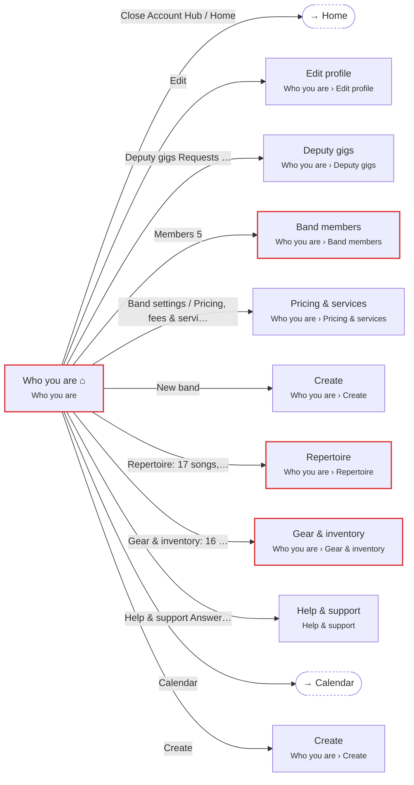
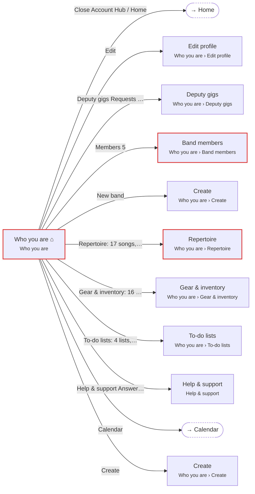

# Settings & Account hub

[← Screen map](README.md) · profile phone-portrait

## admin (10 screens)

_Leo M., admin of the demo band Velvet Static_ · source: [settings.admin.mmd](settings.admin.mmd)

## member (10 screens)

_Leo M. as a member of Velvet Static (not admin)_ · source: [settings.member.mmd](settings.member.mmd)

